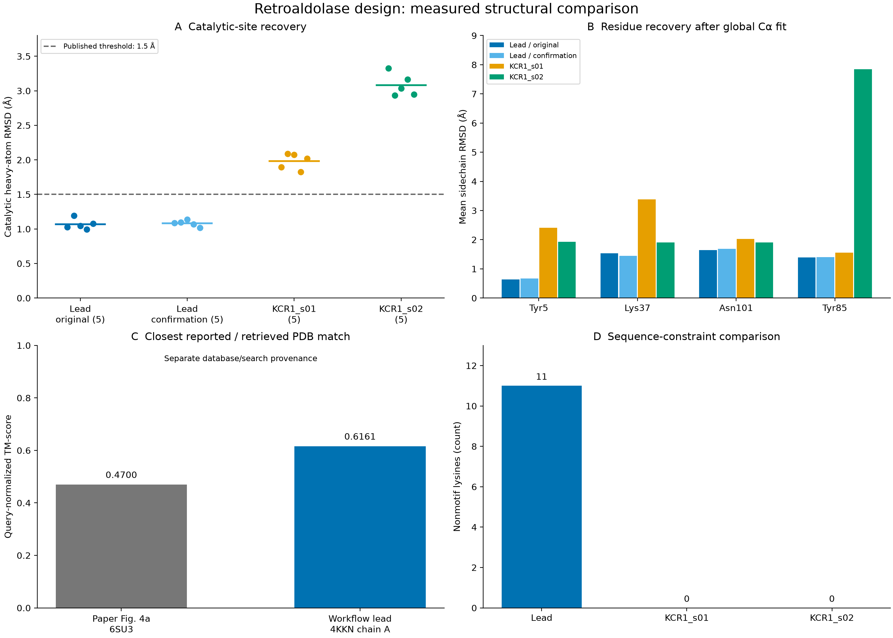
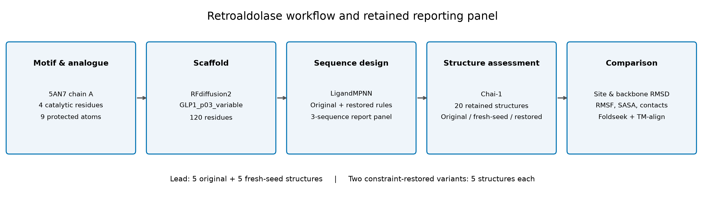

# task_001_rfdiffusion2_retroaldolase — workflow comparison

## Workflow Results

The following comparison uses `GLP1_p03_variable_s02` as the reporting representative, with two restored-sequence-constraint variants shown alongside it.

| Quantity | Published reference | Workflow representative | Definition |
|---|---|---|---|
| Catalytic heavy-atom RMSD |<1.5Å threshold |0.993–1.191Å;10/10 below threshold |41 atoms after catalytic N/CA/C alignment; original5 plus fresh-seed5 |
| Whole-chain Cα RMSD |Separate supporting measurement |0.817–0.998Å |120 matching Cα atoms |
| Closest retrieved PDB TM-score |0.47 to6SU3 |0.6161 to4KKN chainA |Query normalized; local PDB100250101/top20 TM-align; paper and local searches have separate provenance |
| Source-design backbone/ligand clearance |1.5Å contact reference |3.426Å minimum |N/CA/C versus design ligand heavy atoms |
| Full protein/free-ligand heavy contact coverage |1.5Å contact reference |8/10 without pairs below threshold |All protein and submitted free-ligand heavy atoms |
| Designed-enzyme kcat/KM |6.34±0.92M⁻¹s⁻¹ |Not recorded |Published designed enzyme; kept separate from structure measurements |

## Sequence-cohort comparison

| Cohort | Models | Catalytic RMSD range, Å | Mean, Å | Models<1.5Å | Cα RMSD range, Å |
|---|---:|---:|---:|---:|---:|
| Lead / original | 5 | 0.993–1.191 | 1.067 | 5/5 | 0.835–0.998 |
| Lead / confirmation | 5 | 1.017–1.138 | 1.081 | 5/5 | 0.817–0.973 |
| KCR1_s01 | 5 | 1.826–2.088 | 1.981 | 0/5 | 1.165–6.768 |
| KCR1_s02 | 5 | 2.932–3.325 | 3.081 | 0/5 | 2.048–2.279 |

The lead sequence has11 nonmotif lysines. Both KCR1 sequences retain catalytic Lys37 as their only lysine. The two sequence rules are displayed together with the resulting structural measurements; the comparison does not attribute causality to that constraint alone.

## Residue-level comparison

| Residue | Lead original RMSD, Å | Lead confirmation RMSD, Å | KCR1_s01 RMSD, Å | KCR1_s02 RMSD, Å |
|---|---:|---:|---:|---:|
| Tyr5 | 0.633 | 0.671 | 2.413 | 1.925 |
| Lys37 | 1.529 | 1.451 | 3.386 | 1.908 |
| Asn101 | 1.641 | 1.686 | 2.027 | 1.904 |
| Tyr85 | 1.387 | 1.405 | 1.561 | 7.843 |

Residue-level values use a full-chainCα fit, unlike the catalytic-only alignment in the pooled RMSD table. Four-residue averages and pooled41-atom scores therefore remain distinct.

## Assessment scope

The panel retains20 free-CCD-LLK structures for three sequence variants on one scaffold. Apo, methodol and carbinolamine sample counts are0 in this panel. The report selection identifies a comparison representative, not original-task eligibility.

## Saved results

[Report](../../Results/task_001_rfdiffusion2_retroaldolase/GLP1_p03_variable_s02/report.md) · [Candidate inventory](../../Results/task_001_rfdiffusion2_retroaldolase/GLP1_p03_variable_s02/candidates.csv) · [Metrics](../../Results/task_001_rfdiffusion2_retroaldolase/GLP1_p03_variable_s02/metrics.csv) · [Sample metrics](../../Results/task_001_rfdiffusion2_retroaldolase/GLP1_p03_variable_s02/sample_metrics.csv) · [Comparison panel](../../Results/task_001_rfdiffusion2_retroaldolase/GLP1_p03_variable_s02/shortlist.csv) · [Sequences](../../Results/task_001_rfdiffusion2_retroaldolase/GLP1_p03_variable_s02/sequences.fasta) · [Benchmark table](../../Results/task_001_rfdiffusion2_retroaldolase/GLP1_p03_variable_s02/benchmark_comparison.csv).

## Results figures

Every motif point is one retained structure. The gray line is the published1.5Å reference. Residue bars are cohort means; TM-scores retain separate search provenance.

Workflow stages and reporting-panel counts. The Results folder contains the corresponding structures, numeric tables, native records and analysis methods.
