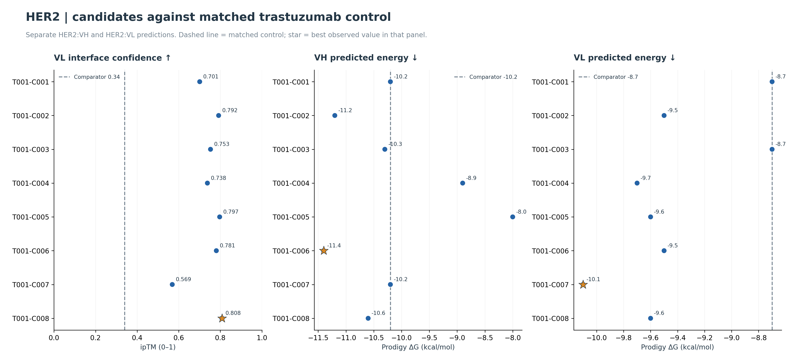
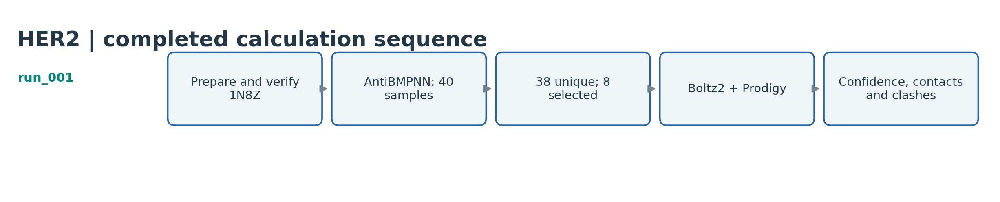

# HER2 / trastuzumab — workflow comparison

Eight selected paired candidates were assessed from 40 generated samples and 38 unique designs. The comparison uses the same recorded Boltz2 and Prodigy procedures for the trastuzumab control and candidates; VH and VL are separate prediction records. **T001-C008** leads VL interface confidence, **T001-C006** leads VH predicted energy, and **T001-C007** leads VL predicted energy.

## Completed workflow

| Run | Generator | Generated / unique | Evaluated |
| --- | --- | --- | --- |
| run_001_antibmpnn_matched | AntiBMPNN | 40 / 38 | 8 candidates + control |

## Candidate comparison against the matched control

Bold scores are favorable to the control in that column. Confidence is on a 0–1 scale; energy is predicted kcal/mol.

| Candidate | VH ipTM ↑ | VL ipTM ↑ | VH ΔG ↓ | VL ΔG ↓ | Residue-ID overlap | Clashes |
| --- | --- | --- | --- | --- | --- | --- |
| REFERENCE | 0.2200 | 0.3400 | -10.2 | -8.7 | 0.0% | 0 |
| T001-C001 | **0.2510** | **0.7010** | -10.2 | -8.7 | 0.0% | 1 |
| T001-C002 | 0.1480 | **0.7920** | **-11.2** | **-9.5** | 6.2% | 3 |
| T001-C003 | 0.1800 | **0.7530** | **-10.3** | -8.7 | 6.2% | 1 |
| T001-C004 | 0.1730 | **0.7380** | -8.9 | **-9.7** | 0.0% | 0 |
| T001-C005 | **0.3480** | **0.7970** | -8.0 | **-9.6** | 0.0% | 1 |
| T001-C006 | **0.3630** | **0.7810** | **-11.4** | **-9.5** | 0.0% | 0 |
| T001-C007 | 0.1950 | **0.5690** | -10.2 | **-10.1** | 6.2% | 3 |
| T001-C008 | **0.2540** | **0.8080** | **-10.6** | **-9.6** | 6.2% | 1 |

The overlap score compares the stored residue identifiers from the predicted interface and the 1N8Z crystal contact set.

## Metric leaders

| Criterion | Candidate | Candidate value | Control value | Candidate − control |
| --- | --- | --- | --- | --- |
| VH predicted energy | **T001-C006** | -11.400 | -10.200 | **-1.200** |
| VL predicted energy | **T001-C007** | -10.100 | -8.700 | **-1.400** |
| VL interface confidence | **T001-C008** | 0.808 | 0.340 | **+0.468** |

The saved shortlist places **T001-C005** first; that original selection is retained separately from these retrospective metric leaders. C008 combines VL ipTM **0.808** with VL ΔG **−9.6 kcal/mol**, while C006 combines VH ΔG **−11.4 kcal/mol** with zero counted clashes. C007 has VL ΔG **−10.1 kcal/mol** and three clashes, illustrating the tradeoff between energy and geometry.

## Benchmark interpretation

The published reference reports Rosetta REF15 optimization endpoints in REU. The tables here report matched local confidence, Prodigy energy and contact calculations in their own definitions. The highlighted gains are therefore gains against the **predicted trastuzumab control**. Residue-ID overlap remains 0–6.2% across the evaluated candidates, which provides useful context alongside the favorable scores.

## Results figures

**Results chart.** The panels compare candidate VL interface confidence and predicted VH/VL energies with the same predicted trastuzumab control. Dashed lines mark that control; stars identify the best observed value in each panel. VH and VL remain separate prediction records.

**Workflow diagram.** The diagram connects input preparation, AntiBMPNN generation, candidate selection, matched prediction and the final confidence, contact and geometry calculations.

## Saved evidence

[run_001_antibmpnn_matched: metrics](../../../results/task_001_her2_trastuzumab_interaction_optimization/run_001_antibmpnn_matched/metrics.csv) · [run_001_antibmpnn_matched: shortlist](../../../results/task_001_her2_trastuzumab_interaction_optimization/run_001_antibmpnn_matched/shortlist.csv) · [run_001_antibmpnn_matched: report](../../../results/task_001_her2_trastuzumab_interaction_optimization/run_001_antibmpnn_matched/report.md). [Published reference](reference.md).
