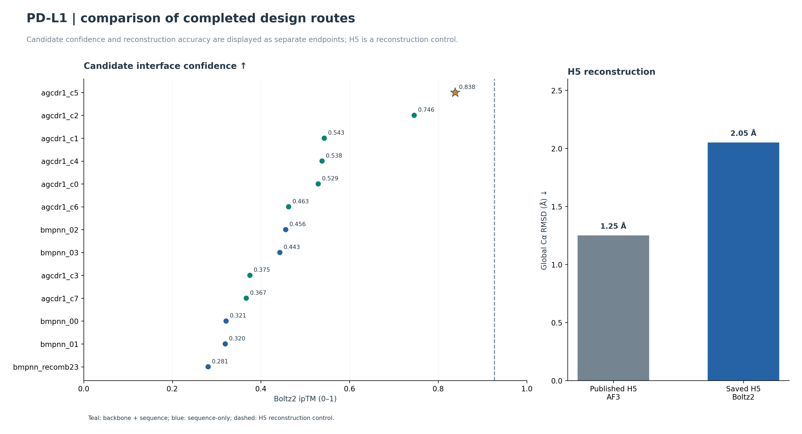
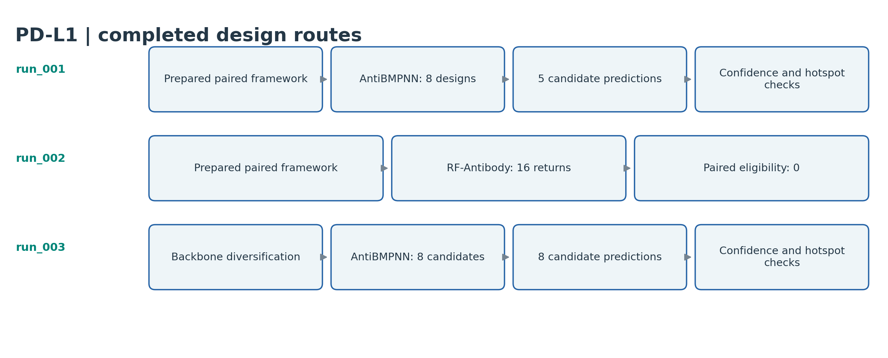

# PD-L1 / scFv — workflow comparison

Three completed routes provide generation and eligibility records; two provide paired candidate scores. **t002r1_agcdr1_c5**, from the backbone-plus-sequence route, has the strongest candidate ipTM (**0.8383**) and recovers two requested hotspots. The H5 structural reconstruction is reported separately from new-candidate evaluation.

## Completed workflows

| Run | Route | Returned designs | Evaluated / eligible |
| --- | --- | --- | --- |
| run_001_antibmpnn_sequence_only | Sequence-only | 8 paired designs + recombination record | 5 evaluated |
| run_002_rf_antibody | RF-Antibody | 16 VH-only returns | 0 paired-eligible |
| run_003_agcdr_antibmpnn | Backbone + sequence | 8 candidates | 8 evaluated |

## Cross-workflow summary

| Run | Evaluated | ipTM range ↑ | pLDDT range (0–1) | Hotspot-positive | Highest-ipTM candidate |
| --- | --- | --- | --- | --- | --- |
| run_001_antibmpnn_sequence_only | 5 | 0.2809–0.4559 | 0.8885–0.9304 | 0/5 | t002r1_bmpnn_02 |
| run_003_agcdr_antibmpnn | 8 | 0.3669–0.8383 | 0.8516–0.9083 | 5/8 | t002r1_agcdr1_c5 |

## Evaluated candidates

| Candidate | Route | ipTM ↑ | pLDDT | Epitope coverage | Hotspots recovered |
| --- | --- | --- | --- | --- | --- |
| t002r1_agcdr1_c5 | Backbone + sequence | 0.8383 | 0.8705 | 0.500 | 2 |
| t002r1_agcdr1_c2 | Backbone + sequence | 0.7458 | 0.8545 | 0.536 | 1 |
| t002r1_agcdr1_c1 | Backbone + sequence | 0.5429 | 0.8667 | 0.571 | 1 |
| t002r1_agcdr1_c4 | Backbone + sequence | 0.5379 | 0.8516 | 0.607 | 2 |
| t002r1_agcdr1_c0 | Backbone + sequence | 0.5292 | 0.8818 | 0.536 | 1 |
| t002r1_agcdr1_c6 | Backbone + sequence | 0.4625 | 0.8525 | 0.500 | 0 |
| t002r1_bmpnn_02 | Sequence-only | 0.4559 | 0.8980 | 0.536 | 0 |
| t002r1_bmpnn_03 | Sequence-only | 0.4427 | 0.8885 | 0.357 | 0 |
| t002r1_agcdr1_c3 | Backbone + sequence | 0.3751 | 0.8711 | 0.464 | 0 |
| t002r1_agcdr1_c7 | Backbone + sequence | 0.3669 | 0.9083 | 0.357 | 0 |
| t002r1_bmpnn_00 | Sequence-only | 0.3213 | 0.8924 | 0.429 | 0 |
| t002r1_bmpnn_01 | Sequence-only | 0.3195 | 0.9304 | 0.000 | 0 |
| t002r1_bmpnn_recomb23 | Sequence-only | 0.2809 | 0.9240 | 0.000 | 0 |

## H5 reference reconstruction

| Calculated endpoint | Published H5 AF3 | Saved H5 Boltz2 | Difference |
| --- | --- | --- | --- |
| Global Cα RMSD ↓ | 1.25 Å | 2.05 Å | +0.80 Å |

The saved H5 reconstruction has ipTM **0.9265**, pLDDT **0.921** and interface-residue recovery **21/23 (91.3%)**. Its CDR RMSDs are H1/H2/H3 = 1.21/2.12/3.72 Å and L1/L2/L3 = 1.79/0.86/3.08 Å.

## Benchmark interpretation

The backbone-plus-sequence route improves the candidate ipTM maximum by **0.3824** over sequence-only (0.8383 versus 0.4559), and five of its eight evaluated candidates recover at least one requested hotspot. This supports that route within the recorded local screen. The strongest candidate confidence is below the H5 reconstruction control, and the saved H5 RMSD is 0.80 Å above the published AF3 result. These are distinct comparisons: the published RMSD benchmarks H5 reconstruction, while route selection uses the calculated candidate confidence and hotspot evidence.

## Results figures

**Results chart.** The left panel compares candidate confidence across the sequence-only and backbone-plus-sequence routes. The right panel compares H5 reconstruction RMSD between the published AF3 result and the saved Boltz2 reconstruction. Candidate confidence and H5 reconstruction accuracy are separate endpoints.

**Workflow diagram.** The three lanes show the completed routes and where each reaches candidate prediction or paired-chain eligibility assessment. The figure preserves the distinction between returned designs and evaluated paired candidates.

## Saved evidence

[H5 control metrics](../../../src/task_002_pdl1_epitope_targeted_scfv_design/run_001_antibmpnn_sequence_only/inputs/controls/h5/metrics.csv) · [run_001_antibmpnn_sequence_only: metrics](../../../results/task_002_pdl1_epitope_targeted_scfv_design/run_001_antibmpnn_sequence_only/metrics.csv) · [run_001_antibmpnn_sequence_only: shortlist](../../../results/task_002_pdl1_epitope_targeted_scfv_design/run_001_antibmpnn_sequence_only/shortlist.csv) · [run_001_antibmpnn_sequence_only: report](../../../results/task_002_pdl1_epitope_targeted_scfv_design/run_001_antibmpnn_sequence_only/report.md) · [run_002_rf_antibody: shortlist](../../../results/task_002_pdl1_epitope_targeted_scfv_design/run_002_rf_antibody/shortlist.csv) · [run_002_rf_antibody: report](../../../results/task_002_pdl1_epitope_targeted_scfv_design/run_002_rf_antibody/report.md) · [run_003_agcdr_antibmpnn: metrics](../../../results/task_002_pdl1_epitope_targeted_scfv_design/run_003_agcdr_antibmpnn/metrics.csv) · [run_003_agcdr_antibmpnn: shortlist](../../../results/task_002_pdl1_epitope_targeted_scfv_design/run_003_agcdr_antibmpnn/shortlist.csv) · [run_003_agcdr_antibmpnn: report](../../../results/task_002_pdl1_epitope_targeted_scfv_design/run_003_agcdr_antibmpnn/report.md). [Published reference](reference.md).
