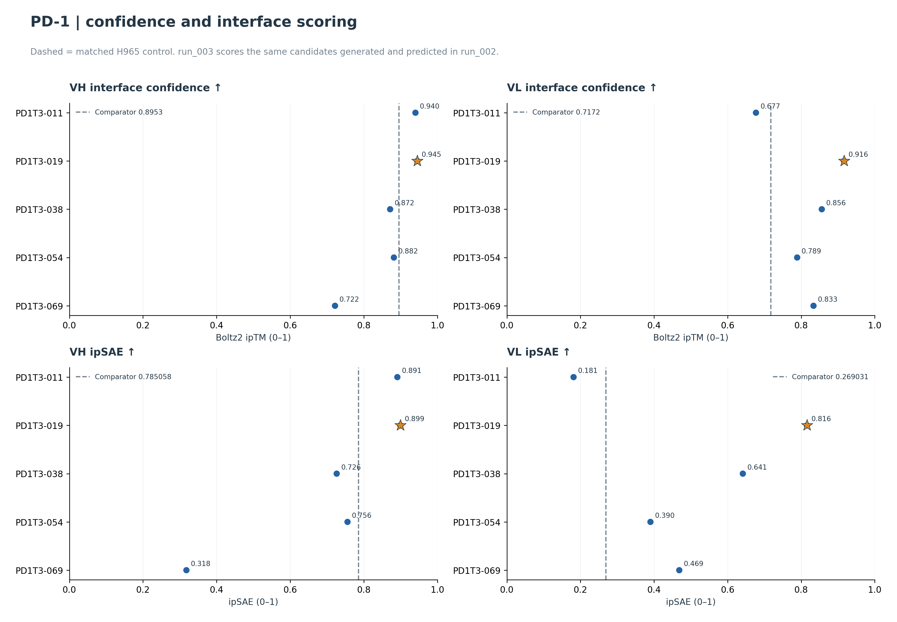
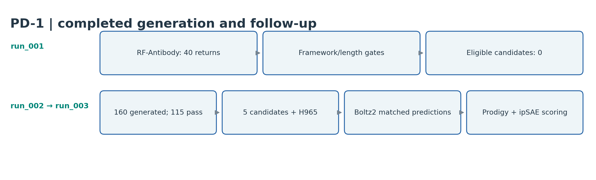

# PD-1 / paired framework — workflow comparison

**PD1T3-019** is the interface-confidence leader and the first-ranked candidate in the saved ipSAE follow-up. It exceeds the matched H965 prediction on both VH/VL ipTM and VH/VL ipSAE. **PD1T3-038** leads candidate predicted energy on both pair records; its VL score is more favorable than H965 and its VH score is less favorable.

## Completed workflows and evaluation lineage

| Run | Role | Calculated output |
| --- | --- | --- |
| run_001_rf_antibody | RF-Antibody design + gating | 40 returned; 0 framework/length-eligible |
| run_002_agcdr_antibmpnn | Backbone diversification + AntiBMPNN + Boltz2 | 160 generated; 115 gate-passing; 5 screened + H965 |
| run_003_prodigy_ipsae_evaluation | Follow-up evaluation of run_002_agcdr_antibmpnn models | 12 Prodigy model records; one ipSAE batch |

## Matched interface-confidence comparison

Bold values exceed the matched control. VH and VL refer to separate PD-1 pair records.

| Candidate | VH ipTM ↑ | VL ipTM ↑ | VH ipSAE ↑ | VL ipSAE ↑ |
| --- | --- | --- | --- | --- |
| H965_control | 0.8953 | 0.7172 | 0.785058 | 0.269031 |
| PD1T3-011 | **0.9404** | 0.6770 | **0.891207** | 0.181306 |
| PD1T3-019 | **0.9453** | **0.9163** | **0.899311** | **0.815554** |
| PD1T3-038 | 0.8716 | **0.8559** | 0.726325 | **0.641322** |
| PD1T3-054 | 0.8818 | **0.7890** | 0.755745 | **0.390241** |
| PD1T3-069 | 0.7218 | **0.8334** | 0.317890 | **0.468605** |

## Predicted energy comparison

Prodigy values retain the saved **raw reported units**. Bold values are lower than the H965 control.

| Candidate | VH score ↓ | VL score ↓ |
| --- | --- | --- |
| H965_control | -13.1 | -9.7 |
| PD1T3-011 | -12.4 | -8.9 |
| PD1T3-019 | -10.9 | **-10.1** |
| PD1T3-038 | -12.6 | **-13.7** |
| PD1T3-054 | -10.9 | **-11.8** |
| PD1T3-069 | -7.9 | **-10.9** |

## Leading candidate gains

| PD1T3-019 endpoint | H965 control | Candidate | Candidate − control |
| --- | --- | --- | --- |
| VH ipTM | 0.8953 | 0.9453 | **+0.0500** |
| VL ipTM | 0.7172 | 0.9163 | **+0.1991** |
| VH ipSAE | 0.785058 | 0.899311 | **+0.114253** |
| VL ipSAE | 0.269031 | 0.815554 | **+0.546523** |

## Benchmark interpretation

The published reference includes panel-level discrimination and recovery benchmarks. This comparison evaluates the generated candidates against a **matched local H965 control** using candidate-level structural scores. **2/5** candidates exceed the VH ipTM control and **4/5** exceed the VL control. PD1T3-019 improves VH/VL ipTM by **+0.0500/+0.1991** and VH/VL ipSAE by **+0.114253/+0.546523**.

PD1T3-038 provides a complementary energy result: VL Prodigy **−13.7** versus H965 **−9.7**, a difference of **−4.0 raw units**; its VH value is −12.6 versus −13.1. The confidence and energy tables therefore support different metric leaders. The saved follow-up shortlist prioritizes PD1T3-019 by the summed VH/VL ipSAE criterion.

## Results figures

**Results chart.** The four panels compare VH/VL ipTM and VH/VL ipSAE with the matched local H965 control. Dashed lines identify the control, while stars highlight PD1T3-019. The follow-up interface scores use the same candidate models as the prediction stage.

**Workflow diagram.** The diagram separates the RF-Antibody generation/gating route from the backbone-plus-sequence route. It also shows that run_003_prodigy_ipsae_evaluation is follow-up scoring of run_002_agcdr_antibmpnn models, rather than a separate candidate-generation campaign.

## Saved evidence

[run_001_rf_antibody: metrics](../../../results/task_003_pd1_framework_guided_cdr_design/run_001_rf_antibody/metrics.csv) · [run_001_rf_antibody: shortlist](../../../results/task_003_pd1_framework_guided_cdr_design/run_001_rf_antibody/shortlist.csv) · [run_001_rf_antibody: report](../../../results/task_003_pd1_framework_guided_cdr_design/run_001_rf_antibody/report.md) · [run_002_agcdr_antibmpnn: metrics](../../../results/task_003_pd1_framework_guided_cdr_design/run_002_agcdr_antibmpnn/metrics.csv) · [run_002_agcdr_antibmpnn: shortlist](../../../results/task_003_pd1_framework_guided_cdr_design/run_002_agcdr_antibmpnn/shortlist.csv) · [run_002_agcdr_antibmpnn: report](../../../results/task_003_pd1_framework_guided_cdr_design/run_002_agcdr_antibmpnn/report.md) · [run_003_prodigy_ipsae_evaluation: metrics](../../../results/task_003_pd1_framework_guided_cdr_design/run_003_prodigy_ipsae_evaluation/metrics.csv) · [run_003_prodigy_ipsae_evaluation: shortlist](../../../results/task_003_pd1_framework_guided_cdr_design/run_003_prodigy_ipsae_evaluation/shortlist.csv) · [run_003_prodigy_ipsae_evaluation: report](../../../results/task_003_pd1_framework_guided_cdr_design/run_003_prodigy_ipsae_evaluation/report.md). [Published reference](reference.md).
