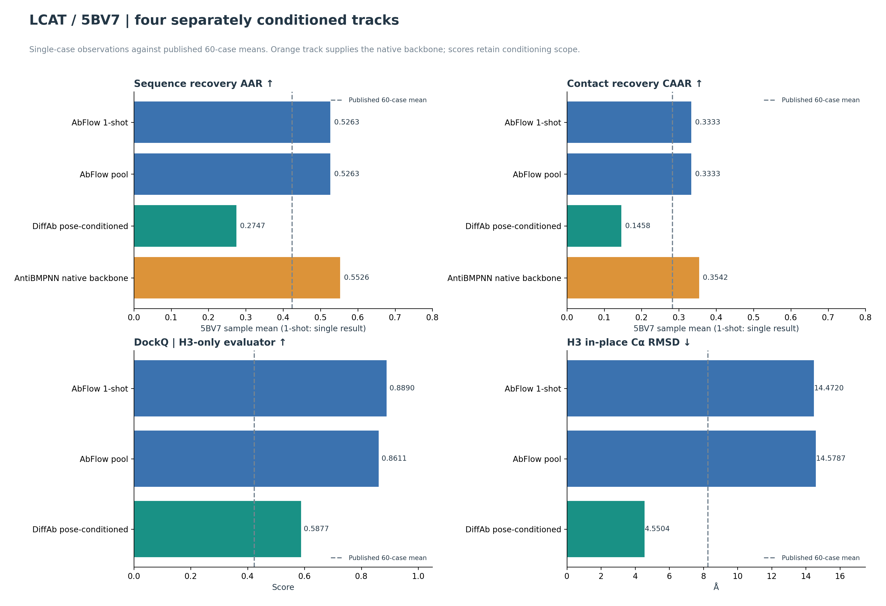
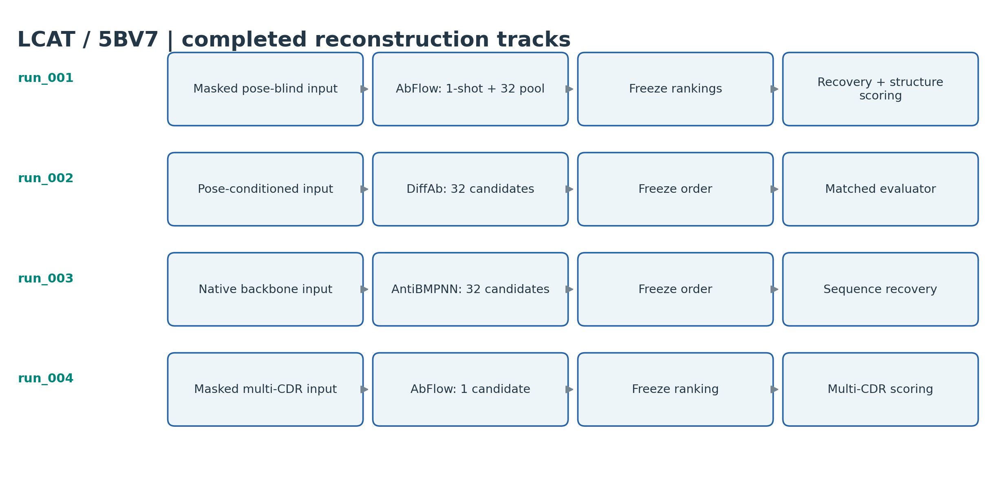

# LCAT / 5BV7 — multi-workflow benchmark comparison

Four completed tracks assess the same 5BV7 reconstruction case under distinct conditioning: pose-blind AbFlow, pose-conditioned DiffAb, fixed native-backbone AntiBMPNN, and multi-CDR AbFlow. **Bold values are numerically favorable to the published aggregate in that metric**, with the sample and conditioning stated in every table. The published Tables 1–2 summarize 60 complexes.

## Completed workflows

| Run | Conditioning | Evaluation scope |
| --- | --- | --- |
| run_001_abflow_h3_reconstruction | Pose-blind H3 | 1-shot + separate 32-sample pool |
| run_002_diffab_local | Pose-conditioned H3 | 32 samples |
| run_003_antibmpnn_native_backbone | Fixed native backbone | 32 sequence samples |
| run_004_abflow_multi_cdr | Separate multi-CDR track | 1 sample |

## Table 1 sequence recovery

| Track | Sample scope | AAR ↑ | CAAR ↑ |
| --- | --- | --- | --- |
| Published 60-case mean | Aggregate | 0.4234 | 0.2824 |
| AbFlow 1-shot | n=1 | **0.5263** | **0.3333** |
| AbFlow pool | n=32 | **0.5263** | **0.3333** |
| DiffAb pose-conditioned | n=32 | 0.2747 | 0.1458 |
| AntiBMPNN native backbone | n=32 | **0.5526** | **0.3542** |

## Table 1 structural measurements

| Track | TM-score ↑ | lDDT ↑ | H3 in-place Cα RMSD Å ↓ | DockQ ↑ |
| --- | --- | --- | --- | --- |
| Published 60-case mean | 0.9736 | 0.8522 | 8.2500 | 0.4230 |
| AbFlow 1-shot | 0.9648 | 0.8105 | 14.4720 | **0.8890** |
| AbFlow pool | 0.9653 | 0.8104 | 14.5787 | **0.8611** |
| DiffAb pose-conditioned | **0.9785** | **0.8956** | **4.5504** | **0.5877** |

DockQ uses the saved H3-only evaluator. H3 placement RMSD is the in-place Appendix C measurement, while the multi-CDR table below uses per-CDR Kabsch alignment. The fixed-backbone track is interpreted through sequence recovery because its coordinates are supplied as input.

## Table 2 multi-CDR reconstruction — run_004

| CDR Kabsch Cα RMSD (Å) ↓ | Published mean | 5BV7 result | Result − mean |
| --- | --- | --- | --- |
| H1 Kabsch | 0.6300 | **0.6063** | -0.0237 |
| H2 Kabsch | 0.5500 | **0.5307** | -0.0193 |
| H3 Kabsch | 1.8300 | 2.6302 | +0.8002 |
| L1 Kabsch | 0.6400 | 0.7824 | +0.1424 |
| L2 Kabsch | 0.2500 | **0.1248** | -0.1252 |
| L3 Kabsch | 0.6500 | 2.0849 | +1.4349 |

| Whole-structure endpoint | Published mean | 5BV7 result |
| --- | --- | --- |
| TM-score ↑ | .9707 | 0.9593 |
| lDDT ↑ | .8151 | 0.7686 |
| DockQ ↑ | .431 | 0.3450 |

## Best observed samples within each track

These highlights are retrospective score extrema. The saved frozen sampling/ranking orders remain the selection records.

| Track | Candidate(s) | Criterion | Value | Selection context |
| --- | --- | --- | --- | --- |
| AbFlow pool | 5bv7_h3_005 | DockQ | 0.8900 | Observed after evaluation |
| DiffAb pose-conditioned | 5bv7_diffab_g012 | RMSD(CA) CDRH3 | 2.7666 | Observed after evaluation |
| Native-backbone sequence recovery | 5bv7_abmpnn_023, 5bv7_abmpnn_007, 5bv7_abmpnn_005, 5bv7_abmpnn_018, 5bv7_abmpnn_028, 5bv7_abmpnn_025, 5bv7_abmpnn_027, 5bv7_abmpnn_020 | AAR H3 | 0.6316 | Observed after evaluation |

## Benchmark interpretation

The pose-blind AbFlow 1-shot has AAR **0.5263**, CAAR **0.3333** and DockQ **0.889**, above published aggregate means of 0.4234, 0.2824 and 0.423. Its H3 placement RMSD is **14.4720 Å**, versus the aggregate 8.25 Å. The 32-sample AbFlow pool has mean DockQ **0.8611**; the pose-conditioned DiffAb track has mean H3 RMSD **4.5504 Å**. These single-case results describe complementary sequence, placement and docking outcomes under the declared input conditions.

The native-backbone track has mean AAR **0.5526** and CAAR **0.3542**, evaluated as sequence recovery with supplied geometry. The multi-CDR result has lower H1, H2 and L2 Kabsch RMSDs than the published means, and higher H3, L1 and L3 RMSDs. Numerical highlights summarize this 5BV7 case; dataset-level method performance retains the 60-case scope of the published reference.

## Results figures

**Results chart.** The bars summarize the 5BV7 H3 tracks, with dashed lines showing the published 60-complex means. Sequence recovery and structural endpoints occupy separate panels. The orange sequence-recovery track receives the native backbone; conditioning and sample scope remain explicit.

**Workflow diagram.** Each lane retains its own input conditioning, sample scope, frozen ordering and evaluator. Pose-blind H3 reconstruction, pose-conditioned generation, fixed-backbone sequence design and multi-CDR reconstruction are shown as distinct tracks.

## Saved evidence

[run_001_abflow_h3_reconstruction: metrics](../../../results/task_004_lcat_reference_fab_cdrh3_reconstruction/run_001_abflow_h3_reconstruction/metrics.csv) · [run_001_abflow_h3_reconstruction: shortlist](../../../results/task_004_lcat_reference_fab_cdrh3_reconstruction/run_001_abflow_h3_reconstruction/shortlist.csv) · [run_001_abflow_h3_reconstruction: report](../../../results/task_004_lcat_reference_fab_cdrh3_reconstruction/run_001_abflow_h3_reconstruction/report.md) · [run_002_diffab_local: metrics](../../../results/task_004_lcat_reference_fab_cdrh3_reconstruction/run_002_diffab_local/metrics.csv) · [run_002_diffab_local: shortlist](../../../results/task_004_lcat_reference_fab_cdrh3_reconstruction/run_002_diffab_local/shortlist.csv) · [run_002_diffab_local: report](../../../results/task_004_lcat_reference_fab_cdrh3_reconstruction/run_002_diffab_local/report.md) · [run_003_antibmpnn_native_backbone: metrics](../../../results/task_004_lcat_reference_fab_cdrh3_reconstruction/run_003_antibmpnn_native_backbone/metrics.csv) · [run_003_antibmpnn_native_backbone: shortlist](../../../results/task_004_lcat_reference_fab_cdrh3_reconstruction/run_003_antibmpnn_native_backbone/shortlist.csv) · [run_003_antibmpnn_native_backbone: report](../../../results/task_004_lcat_reference_fab_cdrh3_reconstruction/run_003_antibmpnn_native_backbone/report.md) · [run_004_abflow_multi_cdr: metrics](../../../results/task_004_lcat_reference_fab_cdrh3_reconstruction/run_004_abflow_multi_cdr/metrics.csv) · [run_004_abflow_multi_cdr: shortlist](../../../results/task_004_lcat_reference_fab_cdrh3_reconstruction/run_004_abflow_multi_cdr/shortlist.csv) · [run_004_abflow_multi_cdr: report](../../../results/task_004_lcat_reference_fab_cdrh3_reconstruction/run_004_abflow_multi_cdr/report.md). [Published reference](reference.md).
