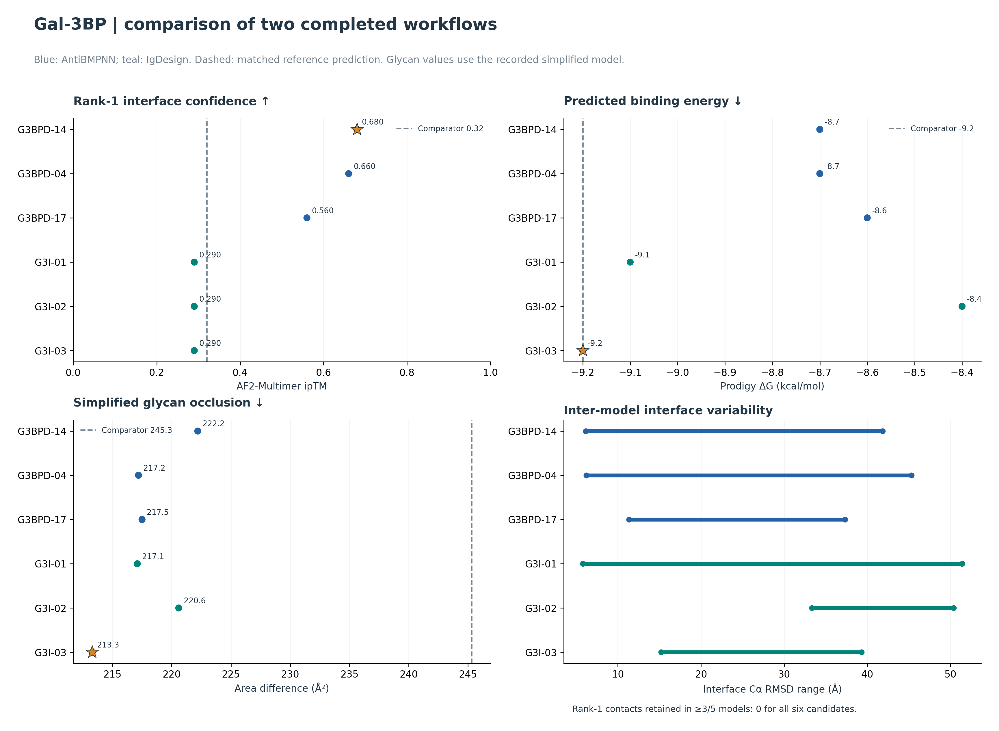
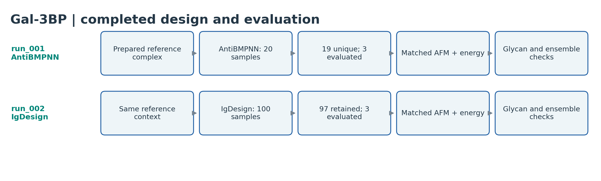

# Gal-3BP — multi-workflow interface comparison

Two completed computational workflows share a reference-complex context and matched candidate evaluation. **G3BPD-14** from AntiBMPNN has the highest rank-1 ipTM (**0.68**). **G3I-03** from IgDesign has the most favorable candidate Prodigy energy (**−9.2 kcal/mol**, equal to the reference) and the lowest recorded simplified glycan occlusion (**213.3 Ų**). These are metric-specific observations alongside the ensemble measurements below.

## Completed workflows

| Run | Generated | Unique / retained | Evaluated | Best ipTM ↑ | Lowest ΔG ↓ |
| --- | --- | --- | --- | --- | --- |
| run_001_antibmpnn_interface_refinement | 20 | 19 | 3 | 0.68 | -8.7 |
| run_002_igdesign_codesign | 100 | 97 | 3 | 0.29 | -9.2 |

## Matched reference endpoints

| Comparator | Rank-1 ipTM | Predicted ΔG (kcal/mol) | Simplified glycan occlusion (Ų) |
| --- | --- | --- | --- |
| Reference prediction | 0.32 | -9.2 | 245.3 |

## Candidate comparison across workflows

Bold values are favorable to the reference in that column. Persistence is the number of rank-1 contact pairs present in at least three of five models, divided by the rank-1 pair count.

| Candidate | Workflow | ipTM ↑ | ΔG ↓ kcal/mol | Occlusion ↓ Ų | Contact persistence | Model RMSD range Å |
| --- | --- | --- | --- | --- | --- | --- |
| G3BPD-14 | AntiBMPNN | **0.68** | -8.7 | **222.2** | 0/6 | 6.12–41.83 |
| G3BPD-04 | AntiBMPNN | **0.66** | -8.7 | **217.2** | 0/7 | 6.22–45.30 |
| G3BPD-17 | AntiBMPNN | **0.56** | -8.6 | **217.5** | 0/2 | 11.34–37.31 |
| G3I-01 | IgDesign | 0.29 | -9.1 | **217.1** | 0/18 | 5.78–51.39 |
| G3I-02 | IgDesign | 0.29 | -8.4 | **220.6** | 0/22 | 33.32–50.39 |
| G3I-03 | IgDesign | 0.29 | -9.2 | **213.3** | 0/19 | 15.21–39.31 |

All six candidates have **zero** counted glycan–antibody clashes under the saved simplified glycan model. Interface-persistence pairs use the saved Cα contact definition and are distinct from heavy-atom interaction counts.

## Metric leaders

| Criterion | Candidate | Value | Reference comparison |
| --- | --- | --- | --- |
| Rank-1 ipTM | **G3BPD-14** | **0.68** | **+0.36** versus 0.32 |
| Candidate predicted energy | **G3I-03** | −9.2 kcal/mol | Equal to reference |
| Simplified glycan occlusion | **G3I-03** | **213.3 Ų** | **−32.0 Ų** versus 245.3 |

## Benchmark interpretation

The AntiBMPNN candidates lead interface confidence, with rank-1 ipTM **0.56–0.68**, versus **0.29** for the three IgDesign candidates and **0.32** for the matched reference. IgDesign contributes the candidate with energy equal to the reference and the lowest modeled glycan occlusion. The glycan values quantify the saved simplified local occlusion model; the published epitope-accessibility analysis retains its own construct and area definition in `reference.md`.

The ensemble measurements qualify these favorable endpoints: **zero rank-1 contact pairs persist in at least three of five models** for every evaluated candidate, and inter-model interface RMSD spans **5.78–51.39 Å** across the six candidates. The candidate highlights therefore identify the strongest observed confidence, energy or occlusion result within these calculations, while the recorded ensemble evidence shows substantial pose variability.

## Results figures

**Results chart.** Blue identifies AntiBMPNN candidates and teal identifies IgDesign candidates; dashed lines mark the matched reference prediction. The panels compare interface confidence, predicted energy, simplified glycan occlusion and inter-model interface RMSD. These complementary endpoints distinguish a favorable single-model score from ensemble pose consistency.

**Workflow diagram.** Both lanes start from the prepared reference context and proceed through generation, candidate retention and matched evaluation. The final checks cover predicted energy, the stated glycan model and interface consistency across models.

## Saved evidence

[run_001_antibmpnn_interface_refinement: metrics](../../../results/task_005_gal3bp_glycan_aware_interface_refinement/run_001_antibmpnn_interface_refinement/metrics.csv) · [run_001_antibmpnn_interface_refinement: shortlist](../../../results/task_005_gal3bp_glycan_aware_interface_refinement/run_001_antibmpnn_interface_refinement/shortlist.csv) · [run_001_antibmpnn_interface_refinement: report](../../../results/task_005_gal3bp_glycan_aware_interface_refinement/run_001_antibmpnn_interface_refinement/report.md) · [run_002_igdesign_codesign: metrics](../../../results/task_005_gal3bp_glycan_aware_interface_refinement/run_002_igdesign_codesign/metrics.csv) · [run_002_igdesign_codesign: shortlist](../../../results/task_005_gal3bp_glycan_aware_interface_refinement/run_002_igdesign_codesign/shortlist.csv) · [run_002_igdesign_codesign: report](../../../results/task_005_gal3bp_glycan_aware_interface_refinement/run_002_igdesign_codesign/report.md). [Published reference](reference.md).
