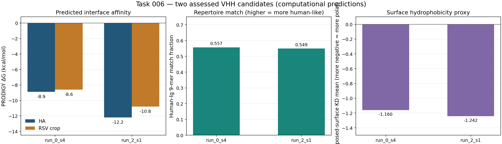
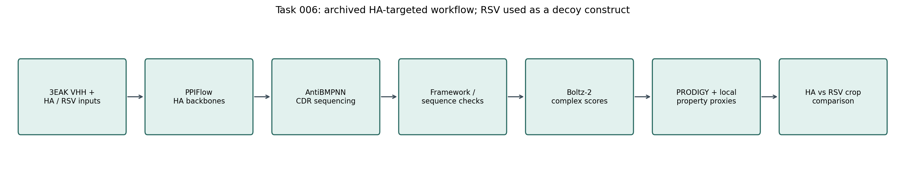

# task_006_vhh_ha_rsv_fixed_framework_design — workflow comparison

## Workflow Results

The following values belong to the current HA-targeted VHH workflow and are kept separate from the published observations.

For aggregation-related surface assessment, this workflow uses **Shrake–Rupley solvent exposure with exposure-filtered Kyte–Doolittle hydrophobicity**. For humanness assessment, it uses **whole-VHH human-immunoglobulin 9-mer reference matching**. These are the selected workflow implementations for the properties assessed by SAP and OASis in the paper, with their own score definitions and native scales.

| Task property | Workflow value | Definition and comparison scope |
| --- | ---: | --- |
| Surface aggregation-related descriptor | **-1.242** | Selected surface-assessment method: mean Kyte–Doolittle hydrophobicity over **55/121** VHH residues with relative exposure >0.3, calculated using Shrake–Rupley exposure. The negative mean describes a hydrophilic average on the KD scale. |
| Whole-sequence hydrophobicity | **-0.217** | Sequence-only KD mean, separate from the surface score. |
| Whole-VHH repertoire matching | **0.5487** | Selected humanness-assessment method: the fraction of unique whole-VHH 9-mers present in the human-immunoglobulin reference collection, **62/113**. |
| HA interface-affinity estimate | **-12.2 kcal/mol** | PRODIGY, with the same partner-selection and service protocol as the RSV comparison. |
| RSV-crop interface-affinity estimate | **-10.8 kcal/mol** | PRODIGY on the RSV comparison construct. |
| HA-versus-RSV preference difference | **+1.4 kcal/mol** | ΔG(RSV crop) − ΔG(HA); positive values favor HA within this matched pair. This is an energy contrast, not a normalized pAE-positive fraction. |

| Supporting structure metric | Workflow value | Interpretation |
| --- | ---: | --- |
| Interaction PAE | **6.895 Å** | Boltz-2 symmetric mean over both full cross-chain PAE blocks; below the published numerical reference of 10 Å, with predictor and averaging definition retained. |
| ipTM | **0.8147** | Boltz-2 interface-confidence score; above the numerical AF3 reference of 0.5, considered separately from the AF3 RMSD requirement. |
| VHH internal-geometry RMSD | **1.929 Å** | VHH-self-aligned over 121 Cα atoms using Biopython SVDSuperimposer, checked against a known rigid transformation. Supports internal VHH structural consistency; it is not an antigen-frame docking test. |
| Antigen-relative VHH RMSD | **20.854 Å** | After alignment on the 170 antigen Cα atoms, the designed docking pose is not reproduced by this assessment. |
| Antigen internal-geometry RMSD | **8.816 Å** | Antigen-self-aligned; antigen deformation also affects interpretation of the target-frame VHH RMSD. |

| Design-validity check | Workflow result |
| --- | --- |
| Scaffold | **3EAK chain A**, compared with the paper's humanized NbBCII10 framework |
| HA hotspots | **B521, B545, B552**; assessment mapping **21, 45, 52** |
| Candidate CDR lengths | **7 / 6 / 13 residues** |
| Protected framework sequence | **95/95 mapped residues preserved** |
| Generation-time framework RMSD | **0.1614 Å**, below the declared **0.5 Å** tolerance |
| Generation-time hotspot coverage | **3/3** |

Provenance and construct scope: the canonical PPIFlow backbone and the sequence-based assessment structures are separate. Generation-time framework preservation and hotspot coverage describe the canonical backbone. The same VHH sequence is retained across the assessment structures. The confidence/RMSD HA construct has P at segment position 9, whereas the HA energy/surface construct has F there. The comparison panel contains **2/2 scored constructs**: a **170-residue HA segment** and an **RSV segment covering residues 250–380**. The RSV crop does not include the complete interprotomer site containing residues 305 and 456.

## Saved results

[Report](../../Results/task_006_vhh_ha_rsv_fixed_framework_design/run_2_s1/report.md) · [Candidate inventory](../../Results/task_006_vhh_ha_rsv_fixed_framework_design/run_2_s1/candidates.csv) · [Assessed metrics](../../Results/task_006_vhh_ha_rsv_fixed_framework_design/run_2_s1/metrics.csv) · [Shortlist](../../Results/task_006_vhh_ha_rsv_fixed_framework_design/run_2_s1/shortlist.csv) · [Sequences](../../Results/task_006_vhh_ha_rsv_fixed_framework_design/run_2_s1/sequences.fasta) · [Benchmark comparison](../../Results/task_006_vhh_ha_rsv_fixed_framework_design/run_2_s1/benchmark_comparison.csv).

## Results figures

Predicted PRODIGY scores, human-Ig 9-mer matching and exposure-filtered KD scores for the two evaluated candidates. Each panel retains its own score definition.

Input structures, HA design, sequence assessment, complex assessment and the HA-versus-RSV-crop comparison.
