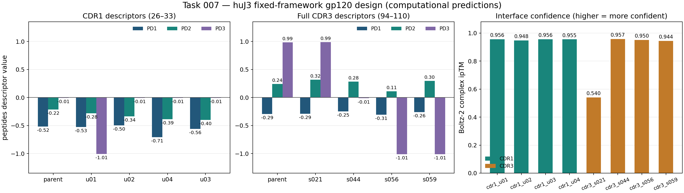
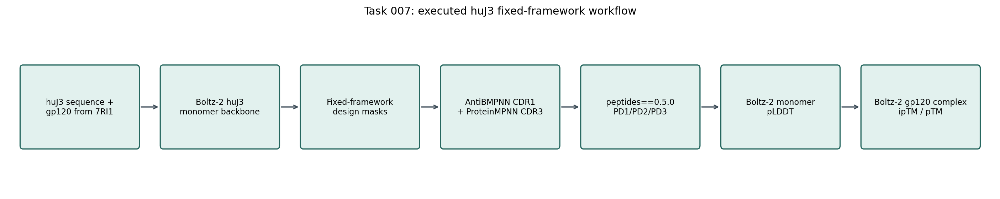

# task_007_huj3_gp120_fixed_framework_design — workflow comparison

## Workflow descriptors alongside the published reference

Our CDR1 variants were generated with AntiBMPNN and our CDR3 variants with ProteinMPNN. We used `peptides==0.5.0` for PD1_volume, PD2_hydro and charge at pH 7.4. Parent and candidate values use the same segment definition; Δ in parentheses is candidate minus our parent, computed from displayed values. PD1 and PD2 are signed physical-descriptor components, not volume in ų or a Kyte–Doolittle sum. PD3 is a theoretical charge for the extracted peptide segment.

| CDR1 segment (26–33) | Our PD1_volume (Δ) | Our PD2_hydro (Δ) | Our PD3_charge (Δ) |
|---|---:|---:|---:|
| Parent `GSIFNQYA` | −0.5175 | −0.2162 | −0.0072 |
| `GFTFSDYA` / `u01` | −0.5275 (−0.0100) | −0.2812 (−0.0650) | −1.0070 (−0.9998) |
| `GFTFSNYA` / `u02` | −0.4975 (+0.0200) | −0.3362 (−0.1200) | −0.0072 (+0.0000) |
| `GFTFSSYA` / `u04` | −0.7075 (−0.1900) | −0.3875 (−0.1713) | −0.0072 (+0.0000) |
| `GFTFSTYA` / `u03` | −0.5612 (−0.0437) | −0.4000 (−0.1838) | −0.0072 (+0.0000) |

For CDR3, the published top-cluster values are repeated as a fixed reference alongside each of our selected candidates.

| Full CDR3 segment (94–110) | Paper top PD1 | Our PD1 (Δ vs parent) | Paper top PD2 | Our PD2 (Δ vs parent) | Paper top PD3 | Our PD3 (Δ vs parent) |
|---|---:|---:|---:|---:|---:|---:|
| Our parent `ARSKSTYISYNSNGYDY` | −0.4271 | −0.2947 | +0.3253 | +0.2406 | +0.9881 | +0.9858 |
| Our `s021` `ARSRSTYISKTDTGYDY` | −0.4271 | −0.2900 (+0.0047) | +0.3253 | +0.3182 (+0.0776) | +0.9881 | +0.9881 (+0.0023) |
| Our `s044` `ARSKSTYISYDQSGYDY` | −0.4271 | −0.2476 (+0.0471) | +0.3253 | +0.2841 (+0.0435) | +0.9881 | −0.0140 (−0.9998) |
| Our `s056` `ARSSSTYISNYMDGYDY` | −0.4271 | −0.3088 (−0.0141) | +0.3253 | +0.1106 (−0.1300) | +0.9881 | −1.0133 (−1.9991) |
| Our `s059` `ARSYSTYISKEDSGYDY` | −0.4271 | −0.2594 (+0.0353) | +0.3253 | +0.2953 (+0.0547) | +0.9881 | −1.0133 (−1.9991) |

## Structural model scores

The paper reports AF3 `ranking_score`; our run reports Boltz-2 `ipTM` and `pTM`. The CDR1 and CDR3 leads in the two columns are different sequences.

| Case | Paper: AF3 candidate | AF3 pLDDT | AF3 `ranking_score` | Our Boltz-2 candidate | Boltz-2 pLDDT | Boltz-2 `ipTM` | Boltz-2 `pTM` |
|---|---|---:|---:|---|---:|---:|---:|
| Parent | huJ3 | 91.75 | 0.9187 | huJ3 | 94.38 |  |  |
| CDR1 | 1-V1 | 92.41 | 0.9216 | `cdr1_u03` (`GFTFSTYA`) | 96.80 | 0.9564 | 0.9407 |
| CDR3 | 3-V1 | 90.87 | 0.9257 | `cdr3_s044` (`ARSKSTYISYDQSGYDY`) | 93.69 | 0.9569 | 0.9373 |

Additional paper AF3 references:

| Published candidate | AF3 pLDDT | AF3 `ranking_score` |
|---|---:|---:|
| S105P | 91.45 | 0.9179 |
| N106S | 92.03 | 0.9140 |
| Y103R | 91.50 | 0.9029 |
| 3-V10 | 91.44 | 0.2608 |

Other candidates assessed with Boltz-2 in our run:

| Our candidate | Boltz-2 mean pLDDT | Boltz-2 `ipTM` | Boltz-2 `pTM` |
|---|---:|---:|---:|
| `cdr1_u01` | 96.55 | 0.9559 | 0.9405 |
| `cdr1_u02` | 96.26 | 0.9480 | 0.9288 |
| `cdr1_u04` | 96.52 | 0.9549 | 0.9409 |
| `cdr3_s021` | 94.92 | 0.5398 | 0.8340 |
| `cdr3_s056` | 94.27 | 0.9502 | 0.9422 |
| `cdr3_s059` | 93.60 | 0.9442 | 0.9304 |

## Saved results

[Report](../../Results/task_007_huj3_gp120_fixed_framework_design/run_20261109_001/report.md) · [Sequences](../../Results/task_007_huj3_gp120_fixed_framework_design/run_20261109_001/sequences.fasta) · [Property results](../../Results/task_007_huj3_gp120_fixed_framework_design/run_20261109_001/property_predictions_paper_style.csv).

## Results figures

peptides==0.5.0 PD1/PD2/PD3 values for the parent and candidates in each segment, with Boltz-2 complex ipTM by candidate. Descriptor panels and ipTM retain their native scales.

Input preparation, fixed-backbone CDR design, descriptor calculation and Boltz-2 structure assessment.
