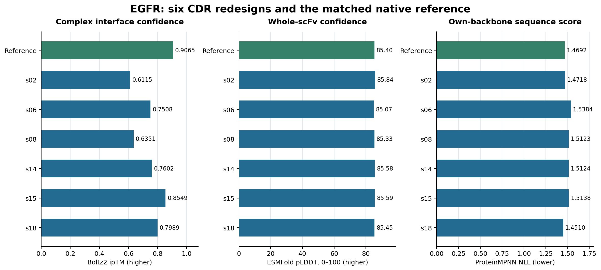
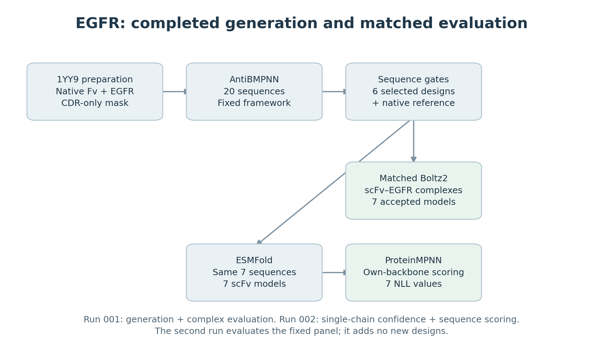

# EGFR: benchmark comparison

Six CDR redesigns were evaluated against the same cetuximab scFv control. `cet_008_r1_s15` had the highest candidate Boltz2 ipTM (0.8549), below the matched reference (0.9065). `cet_008_r1_s18` had the lowest candidate ProteinMPNN score on its own ESMFold backbone (1.4510; reference 1.4692).

## Completed workflows

| Completed run | Method and scope | Saved output |
| --- | --- | --- |
| `run_001_antibmpnn_matched` | AntiBMPNN CDR redesign; matched Boltz2 scFv–EGFR prediction | 20 generated sequences → 6 selected candidates + reference |
| `run_002_esmfold_proteinmpnn_evaluation` | ESMFold and ProteinMPNN score-only evaluation | The same 6 candidates + reference; 7 single-chain predictions |

The second run evaluates the first run's candidates; it does not add a new design pool. Each matched complex prediction uses the same prepared EGFR construct and prediction settings.

## Calculated results

| Entity | Boltz2 ipTM ↑ | Boltz2 pTM ↑ | ESMFold mean pLDDT ↑ | ProteinMPNN NLL ↓ |
| --- | --- | --- | --- | --- |
| `reference` | 0.9065 | 0.8413 | 85.40 | 1.4692 |
| `cet_008_r1_s02` | 0.6115 | 0.7595 | 85.84 | 1.4718 |
| `cet_008_r1_s06` | 0.7508 | 0.8029 | 85.07 | 1.5384 |
| `cet_008_r1_s08` | 0.6351 | 0.7221 | 85.33 | 1.5123 |
| `cet_008_r1_s14` | 0.7602 | 0.7836 | 85.58 | 1.5124 |
| `cet_008_r1_s15` | 0.8549 | 0.8575 | 85.59 | 1.5138 |
| `cet_008_r1_s18` | 0.7989 | 0.8344 | 85.45 | 1.4510 |

ipTM and pTM use a 0–1 scale. ESMFold pLDDT uses a 0–100 scale over the complete 241-residue scFv. ProteinMPNN scores each submitted sequence on its own ESMFold backbone, without redesign; these values combine sequence and backbone differences.

## Benchmark interpretation

Candidate ESMFold confidence spans 85.07–85.84, compared with 85.40 for the matched reference. Candidate own-backbone ProteinMPNN scores span 1.4510–1.5384. The catalog snapshot reports whole-structure pLDDT of 82.3986–83.7115 and original-sequence ProteinMPNN scores of 1.4344–1.4958. Those ranges provide external context; the saved catalog prediction settings were not reproduced exactly. Catalog redesigned-sequence scores are a different endpoint.

All six candidates score below the matched reference on complex ipTM. Increased single-chain confidence or a lower sequence likelihood score therefore does not establish improved EGFR binding. These are computational evaluations; candidate affinity was not measured.

## Figures

Calculated results for all six candidates and the matched reference: complex ipTM (0–1, higher), whole-scFv ESMFold pLDDT (0–100, higher), and ProteinMPNN own-backbone negative log likelihood (lower).

Two completed runs: experimental-complex preparation → 20 AntiBMPNN designs → six selected candidates → matched Boltz2 complex evaluation; the same seven sequences then receive ESMFold and ProteinMPNN evaluation.

## Saved evidence

- `run_001_antibmpnn_matched`: [metrics](../../../results/task_008_egfr_scfv_design/run_001_antibmpnn_matched/metrics.csv), [shortlist](../../../results/task_008_egfr_scfv_design/run_001_antibmpnn_matched/shortlist.csv), [report](../../../results/task_008_egfr_scfv_design/run_001_antibmpnn_matched/report.md).
- `run_002_esmfold_proteinmpnn_evaluation`: [metrics](../../../results/task_008_egfr_scfv_design/run_002_esmfold_proteinmpnn_evaluation/metrics.csv), [shortlist](../../../results/task_008_egfr_scfv_design/run_002_esmfold_proteinmpnn_evaluation/shortlist.csv), [report](../../../results/task_008_egfr_scfv_design/run_002_esmfold_proteinmpnn_evaluation/report.md).

[Published reference and metric definitions](reference.md).
