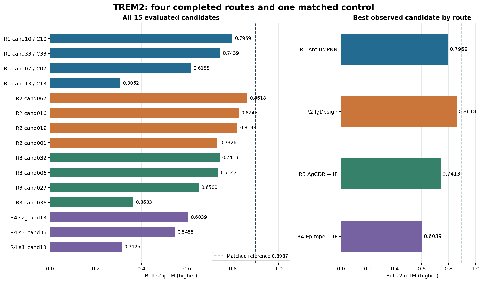
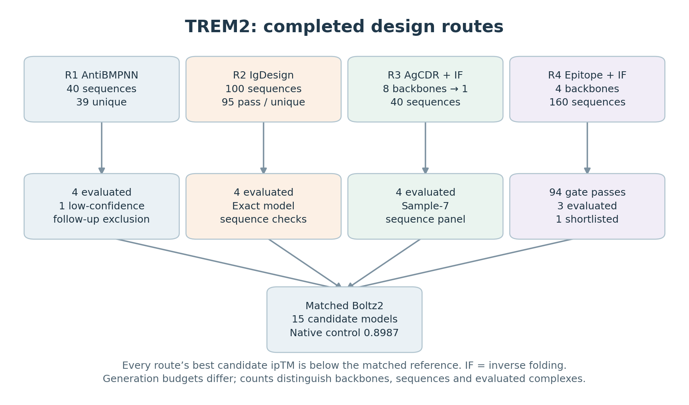

# TREM2: benchmark comparison

Four completed design routes produced 15 candidate complex predictions. The strongest candidate interface score was IgDesign `cand067` (ipTM 0.8618), below the matched reference control (0.8987). Each route's best candidate remained below that control.

## Completed workflows

| Completed run | Method and scope | Saved output |
| --- | --- | --- |
| `run_001_antibmpnn_matched` | R1: AntiBMPNN on the reference backbone | 40 generated → 40 mask passes / 39 unique → 4 evaluated |
| `run_002_igdesign_local` | R2: IgDesign heavy-CDR redesign | 100 generated → 95 passing unique candidates → 4 evaluated |
| `run_003_agcdr_backbone` | R3: AgCDR backbone design plus local AntiBMPNN | 8 backbone samples → sample 7 → 40 sequences → 4 evaluated |
| `run_004_epitope_abgen_local` | R4: Local epitope-conditioned backbone design plus AntiBMPNN | 4 backbones → 160 sequences → 94 passes → 3 evaluated |

R4's per-backbone passing counts were 0, 25, 32 and 37. The sample-0 sequences introduced CDR cysteines and were excluded by the sequence gate. Only predictions with verified submitted-sequence identity enter the comparison.

## Matched reference control

| Metric | Matched control | Published catalog reference |
| --- | --- | --- |
| Boltz2 ipTM ↑ | 0.8987 | 0.9009589553 |
| Boltz2 pTM ↑ | 0.9316 | 0.9327809811 |
| Complex pLDDT ↑ (raw 0–1) | 0.9424 | 0.928986609 |
| Complex PDE ↓ | 0.3989 | 0.3970271945 |

The catalog column supplies external reference context. Candidate differences below use the matched execution control, with the same prepared complex inputs.

## Route comparison

| Route | Highest-ipTM candidate | Evaluated ipTM range | Best ΔipTM vs control |
| --- | --- | --- | --- |
| R1 | `cand10_T009-C10` | 0.3062–0.7969 | -0.1018 |
| R2 | `cand067` | 0.7326–0.8618 | -0.0369 |
| R3 | `cand032` | 0.3633–0.7413 | -0.1574 |
| R4 | `s2_cand13` | 0.3125–0.6039 | -0.2948 |

## Candidate results

| Route | Candidate | ipTM ↑ | pTM ↑ | Evaluation status |
| --- | --- | --- | --- | --- |
| R1 | `cand10_T009-C10` | 0.7969 | 0.8913 | Evaluated |
| R1 | `cand33_T009-C33` | 0.7439 | 0.8736 | Evaluated |
| R1 | `cand07_T009-C07` | 0.6155 | 0.8306 | Evaluated |
| R1 | `cand13_T009-C13` | 0.3062 | 0.7215 | Excluded: low interface confidence |
| R2 | `cand067` | 0.8618 | 0.9198 | Evaluated |
| R2 | `cand016` | 0.8247 | 0.9047 | Evaluated |
| R2 | `cand019` | 0.8193 | 0.9088 | Evaluated |
| R2 | `cand001` | 0.7326 | 0.8729 | Evaluated |
| R3 | `cand032` | 0.7413 | 0.8636 | Evaluated |
| R3 | `cand006` | 0.7342 | 0.8378 | Evaluated |
| R3 | `cand027` | 0.6500 | 0.8112 | Evaluated |
| R3 | `cand036` | 0.3633 | 0.6396 | Evaluated |
| R4 | `s2_cand13` | 0.6039 | 0.7904 | Evaluated |
| R4 | `s3_cand36` | 0.5455 | 0.8056 | Evaluated |
| R4 | `s1_cand13` | 0.3125 | 0.6944 | Evaluated |

The low-confidence R1 candidate is retained to show the full evaluated panel and its selection outcome. Run shortlists record the decisions for each route; evaluated counts do not imply that every candidate was retained for follow-up.

## Benchmark interpretation

The best candidate scores rank R2 > R1 > R3 > R4 under the saved matched Boltz2 protocol. None improves interface confidence over the reference. This is a completed computational comparison with a negative optimization outcome on this endpoint. The routes have different generation budgets and masks, so their best scores do not constitute an equal-budget method benchmark. No candidate binding measurement is included.

## Figures

All 15 candidate ipTM scores (0–1, higher) grouped by route, with the matched reference at 0.8987. The route summary uses the maximum observed candidate score, including all recorded evaluated models.

Four completed generation routes feed the same matched Boltz2 comparison. Counts distinguish backbone samples, generated sequences, sequence-gate passes and evaluated complexes; the reference control is shared.

## Saved evidence

- `run_001_antibmpnn_matched`: [metrics](../../../results/task_009_trem2_scfv_design/run_001_antibmpnn_matched/metrics.csv), [shortlist](../../../results/task_009_trem2_scfv_design/run_001_antibmpnn_matched/shortlist.csv), [report](../../../results/task_009_trem2_scfv_design/run_001_antibmpnn_matched/report.md).
- `run_002_igdesign_local`: [metrics](../../../results/task_009_trem2_scfv_design/run_002_igdesign_local/metrics.csv), [shortlist](../../../results/task_009_trem2_scfv_design/run_002_igdesign_local/shortlist.csv), [report](../../../results/task_009_trem2_scfv_design/run_002_igdesign_local/report.md).
- `run_003_agcdr_backbone`: [metrics](../../../results/task_009_trem2_scfv_design/run_003_agcdr_backbone/metrics.csv), [shortlist](../../../results/task_009_trem2_scfv_design/run_003_agcdr_backbone/shortlist.csv), [report](../../../results/task_009_trem2_scfv_design/run_003_agcdr_backbone/report.md).
- `run_004_epitope_abgen_local`: [metrics](../../../results/task_009_trem2_scfv_design/run_004_epitope_abgen_local/metrics.csv), [shortlist](../../../results/task_009_trem2_scfv_design/run_004_epitope_abgen_local/shortlist.csv), [report](../../../results/task_009_trem2_scfv_design/run_004_epitope_abgen_local/report.md).

[Published reference and metric definitions](reference.md).
