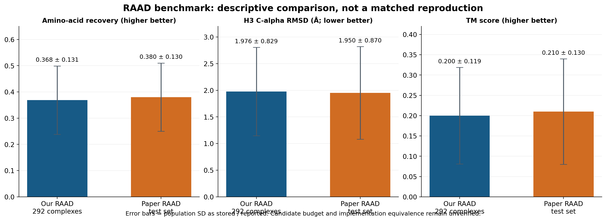
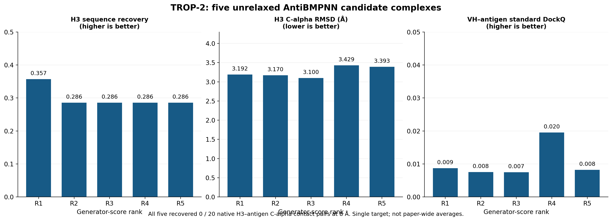
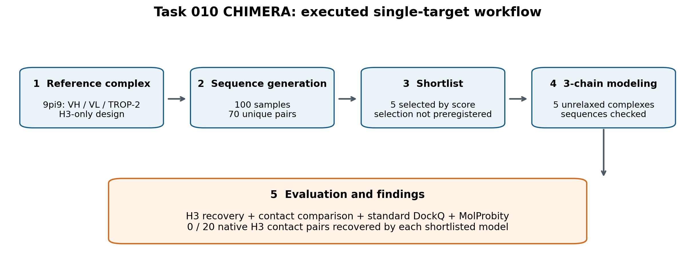

# task_010_chimera_epitope_conditioned_cdr_design — workflow comparison

## Workflow Results

The local RAAD 292-complex evaluation and the TROP-2 five-candidate panel answer different questions. The former evaluates generated H3 loops in native framework context; the latter evaluates independently predicted unrelaxed three-chain complexes for one target. Neither is an exact published-protocol reproduction.

| RAAD benchmark metric | Local mean ± population SD | Paper RAAD mean ± SD | Scope |
|---|---:|---:|---|
| H3 AAR | 0.368 ± 0.131 | 0.38 ± 0.13 | Descriptive; protocol/candidate budget not fully matched |
| H3 Cα RMSD (Å) | 1.976 ± 0.829 | 1.95 ± 0.87 | Descriptive; both H3 self-aligned |
| TM | 0.200 ± 0.119 | 0.21 ± 0.13 | Descriptive; implementation equivalence unverified |
| Native-target PPL from saved generation logits | 9.045 ± 4.294 | 3.31 ± 0.47 | Context and paper implementation equivalence not established |
| CAAR | 0.195 ± 0.230 | 0.21 ± 0.23 | Different native contact masks; not directly comparable |
| H3-only Cα DockQ-like proxy | 0.645 ± 0.220 | 0.64 ± 0.21 | Scope/implementation unverified; neither labeled canonical DockQ here |

## TROP-2 shortlist

Five generator-ranked unique sequences were structurally modeled; all recovered **0/20** native H3–antigen 8 Å Cα contact pairs. Rank 4 epitope F1 = 0.25 uses antigen-residue overlap, a different metric. Scores are single-target values, not estimates of the test-set mean. The subset was declared after rank-2 reference evaluation; 65 other unique sequences were not structurally evaluated. Structures are unrelaxed; MolProbity measurements are not pass/fail and do not establish affinity.

## Saved results

[Report](../../Results/task_010_chimera_epitope_conditioned_cdr_design/run_001_trop2_chimera/report.md) · [Candidate inventory](../../Results/task_010_chimera_epitope_conditioned_cdr_design/run_001_trop2_chimera/candidates.csv) · [Candidate metrics](../../Results/task_010_chimera_epitope_conditioned_cdr_design/run_001_trop2_chimera/metrics.csv) · [Shortlist](../../Results/task_010_chimera_epitope_conditioned_cdr_design/run_001_trop2_chimera/shortlist.csv) · [Sequences](../../Results/task_010_chimera_epitope_conditioned_cdr_design/run_001_trop2_chimera/sequences.fasta) · [Benchmark CSV](../../Results/task_010_chimera_epitope_conditioned_cdr_design/run_001_trop2_chimera/benchmark_comparison.csv).

## Results figures

Published vs local RAAD means and standard deviations. Numerical proximity is descriptive, not proof of a matched reproduction.

One independently predicted unrelaxed complex per generator rank; metric definitions and scale are shown in each panel.

Workflow scope, model count, selection limitation and recovered-contact result.
