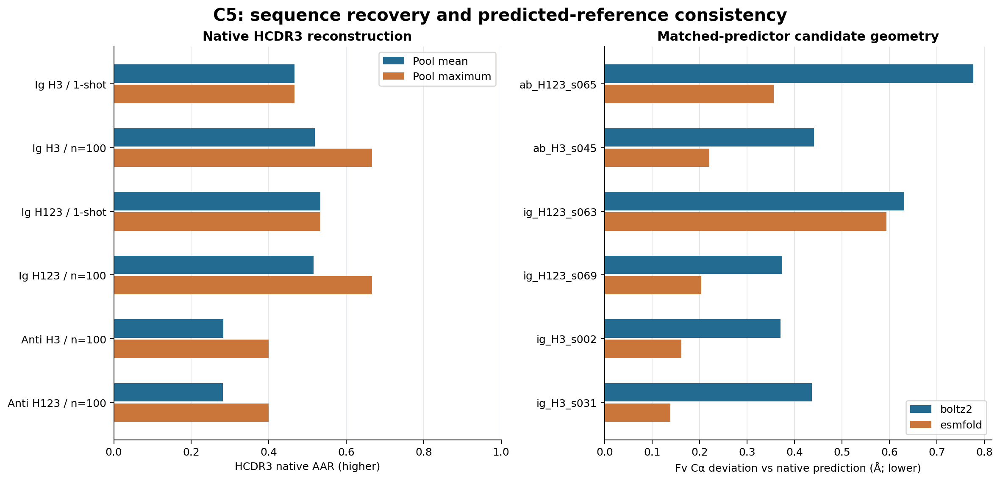
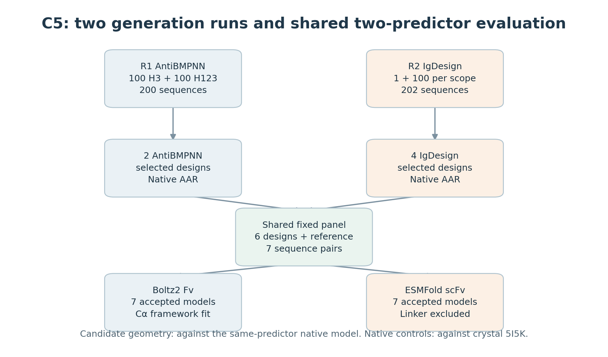

# Complement C5: benchmark comparison

Two completed runs compare Eculizumab heavy-CDR reconstruction by AntiBMPNN and IgDesign. IgDesign recovered up to 0.6667 of native HCDR3 positions in each 100-sample scope; AntiBMPNN reached 0.4000. Six selected designs were evaluated by both Boltz2 and ESMFold.

## Completed workflows

| Completed run | Method and scope | Saved output |
| --- | --- | --- |
| `run_001_antibmpnn_matched` | AntiBMPNN HCDR3-only and HCDR123 redesign; shared structural evaluation | 100 sequences per scope; 2 AntiBMPNN + 4 IgDesign candidates + reference; 14 structural models |
| `run_002_igdesign_reconstruction` | IgDesign masked native reconstruction | 1-shot + 100-sample pool per scope; 202 sequences; 4 candidates evaluated in run_001 |

The AntiBMPNN run's candidate table includes 200 sequences generated there and four imported IgDesign evaluation entries. Those four are labelled with their source run and are not additional AntiBMPNN generations.

## Native-sequence recovery

| Method and scope | Samples | Mean HCDR1 AAR | Mean HCDR2 AAR | Mean HCDR3 AAR | Maximum HCDR3 AAR |
| --- | --- | --- | --- | --- | --- |
| IgDesign HCDR3, 1-shot | 1 | — | — | 0.4667 | 0.4667 |
| IgDesign HCDR3, 100-sample pool | 100 | — | — | 0.5193 | 0.6667 |
| IgDesign HCDR123, 1-shot | 1 | 0.6250 | 0.5000 | 0.5333 | 0.5333 |
| IgDesign HCDR123, 100-sample pool | 100 | 0.6450 | 0.7250 | 0.5160 | 0.6667 |
| AntiBMPNN HCDR3, 100-sample pool | 100 | 1.0000 | 1.0000 | 0.2827 | 0.4000 |
| AntiBMPNN HCDR123, 100-sample pool | 100 | 0.6262 | 0.6275 | 0.2820 | 0.4000 |

AAR uses VH positions 26–33, 51–58 and 97–111 for HCDR1, HCDR2 and HCDR3. Framework and VL remain fixed; HCDR1/2 are also protected in the HCDR3-only scope. The single-sample rows are separate executions from the 100-sample pools. IgDesign HCDR123 per-CDR maxima in the 100-sample pool are 0.7500, 0.8750 and 0.6667; these maxima need not occur in one sequence.

The released CSV's inverse-folding sequence rows give HCDR3 AAR means/maxima of 0.4828/0.5333 for the 62 HCDR3-only rows and 0.4776/0.5333 for the 67 HCDR123 rows. These values are derived from the released sequence set; that set is not a published 1-shot or best-of-100 reconstruction panel.

## Native control against the experimental structure

| Predictor | Fv scRMSD (Å) | HCDR3 scRMSD (Å) | HCDR123 scRMSD (Å) |
| --- | --- | --- | --- |
| boltz2 | 1.1610 | 1.7256 | 1.4351 |
| esmfold | 1.2664 | 2.2404 | 1.7187 |

The native control is compared with the prepared 5I5K crystal Fv using Cα atoms, after a single Kabsch fit on VH non-CDR residues plus all VL residues. The released positive-control Fv range is 1.2044–1.3017 Å across four predictors. Our Boltz2 control (1.1610 Å) is below that range; our ESMFold control (1.2664 Å) is within it. Prediction and evaluator differences prevent treating this as an exact reproduction of the released scores.

## Candidate consistency against the same-predictor native model

| Candidate | Boltz2 Fv (Å) ↓ | Boltz2 HCDR3 (Å) ↓ | ESMFold Fv (Å) ↓ | ESMFold HCDR3 (Å) ↓ |
| --- | --- | --- | --- | --- |
| `ab_hcdr123_s065` | 0.777 | 2.718 | 0.356 | 1.235 |
| `ab_hcdr3only_s045` | 0.441 | 1.419 | 0.221 | 0.841 |
| `ig_hcdr123_s063` | 0.631 | 2.332 | 0.594 | 2.262 |
| `ig_hcdr123_s069` | 0.374 | 0.712 | 0.204 | 0.587 |
| `ig_hcdr3_s002` | 0.371 | 1.021 | 0.162 | 0.525 |
| `ig_hcdr3_s031` | 0.437 | 1.083 | 0.139 | 0.362 |

Candidate geometry uses the same Cα/framework fit, with the native model from the corresponding predictor as comparator. ESMFold predicts VH–linker–VL; the 15-residue linker is removed before Fv measurement. These candidate values describe deviation from a predicted native Fv. The native-versus-crystal values above answer a different question.

## Benchmark interpretation

IgDesign has higher native HCDR3 recovery in the recorded pools. Both predictors place `ig_hcdr123_s069` close to their native-model geometry (HCDR3 0.712/0.587 Å), while `ig_hcdr123_s063` deviates more in both tracks (2.332/2.262 Å). The lowest whole-Fv deviation belongs to `ig_hcdr3_s002` for Boltz2 (0.371 Å) and `ig_hcdr3_s031` for ESMFold (0.139 Å). Sequence recovery and geometric consistency are separate endpoints; neither measures binding affinity.

## Figures

Left: mean and maximum HCDR3 AAR (0–1, higher) in the saved generation pools, including the separate IgDesign 1-shot samples. Right: all six candidates’ Cα Fv deviation (Å, lower) from the corresponding Boltz2 or ESMFold native prediction.

Two generation runs produce 200 AntiBMPNN and 202 IgDesign sequences. A shared panel of two AntiBMPNN designs, four IgDesign designs and one native control is evaluated by both predictors, giving 14 accepted models.

## Saved evidence

- `run_001_antibmpnn_matched`: [metrics](../../../results/task_013_c5_igdesign_cdr_redesign/run_001_antibmpnn_matched/metrics.csv), [shortlist](../../../results/task_013_c5_igdesign_cdr_redesign/run_001_antibmpnn_matched/shortlist.csv), [report](../../../results/task_013_c5_igdesign_cdr_redesign/run_001_antibmpnn_matched/report.md).
- `run_002_igdesign_reconstruction`: [metrics](../../../results/task_013_c5_igdesign_cdr_redesign/run_002_igdesign_reconstruction/metrics.csv), [shortlist](../../../results/task_013_c5_igdesign_cdr_redesign/run_002_igdesign_reconstruction/shortlist.csv), [report](../../../results/task_013_c5_igdesign_cdr_redesign/run_002_igdesign_reconstruction/report.md).

[Published reference and metric definitions](reference.md).
