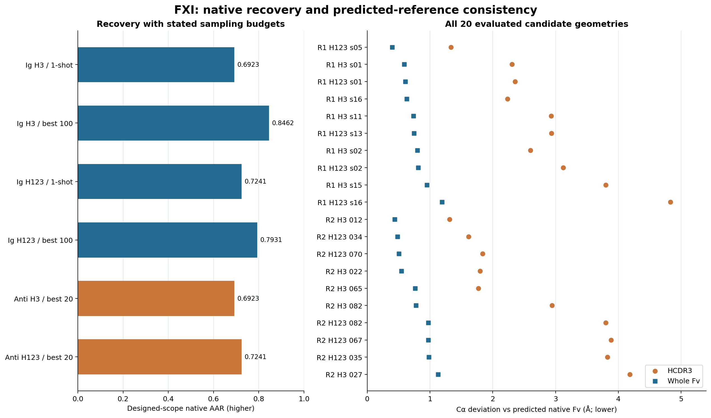
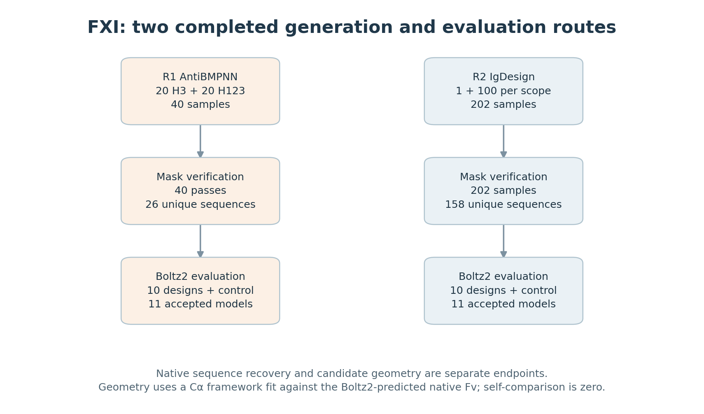

# Factor XI: benchmark comparison

Two completed runs redesign the Osocimab heavy-chain CDRs. IgDesign's best designed-scope recovery is 0.8462 for HCDR3 and 0.7931 for HCDR123. The closest evaluated whole-Fv geometry is AntiBMPNN `t014r001_hcdr123_scope_s05` (0.3978 Å), with designed-scope AAR 0.6897.

## Completed workflows

| Completed run | Method and scope | Saved output |
| --- | --- | --- |
| `run_001_antibmpnn_fixed_backbone` | R1: AntiBMPNN fixed-backbone redesign | 20 HCDR3 + 20 HCDR123 samples; 40 mask passes; 26 unique sequences; 10 evaluated designs |
| `run_002_igdesign_native_reconstruction` | R2: IgDesign masked native reconstruction | 1 + 100 samples per scope; 202 samples; 158 unique sequences; 10 evaluated designs |

The structural panel contains 20 distinct candidate entries and a native control. Both run packages retain a control prediction, for 22 accepted model files across the two packages. All generation pools preserve VL and VH framework residues.

## Native-sequence recovery

| Method | Designed scope | Sampling rule | Samples | Designed-scope AAR ↑ |
| --- | --- | --- | --- | --- |
| IgDesign | HCDR3 | 1-shot | 1 | 0.6923 |
| IgDesign | HCDR3 | Best of 100 | 100 | 0.8462 |
| IgDesign | HCDR123 | 1-shot | 1 | 0.7241 |
| IgDesign | HCDR123 | Best of 100 | 100 | 0.7931 |
| AntiBMPNN | HCDR3 | Best of 20 | 20 | 0.6923 |
| AntiBMPNN | HCDR123 | Best of 20 | 20 | 0.7241 |

Joint HCDR123 AAR is the length-weighted recovery across one candidate's 29 designed positions: VH 26–33, 51–58 and 97–109. HCDR3-only AAR uses its 13 positions. The IgDesign single-sample executions are separate from the 100-sample pools. AntiBMPNN maxima use 20 samples per scope, so those maxima have a different sampling budget.

## Structural comparison

| Route | Candidate | Designed-scope AAR | CDR substitutions | HCDR3 (Å) ↓ | HCDR123 (Å) ↓ | Fv (Å) ↓ |
| --- | --- | --- | --- | --- | --- | --- |
| R1 | `t014r001_hcdr123_scope_s05` | 0.6897 | 9 | 1.3367 | 0.9529 | 0.3978 |
| R1 | `t014r001_hcdr3_scope_s01` | 0.5385 | 6 | 2.3062 | 1.5531 | 0.5910 |
| R1 | `t014r001_hcdr123_scope_s01` | 0.6897 | 9 | 2.3541 | 1.5982 | 0.6090 |
| R1 | `t014r001_hcdr3_scope_s16` | 0.6154 | 5 | 2.2366 | 1.5185 | 0.6317 |
| R1 | `t014r001_hcdr3_scope_s11` | 0.6154 | 5 | 2.9316 | 1.9697 | 0.7386 |
| R1 | `t014r001_hcdr123_scope_s13` | 0.6897 | 9 | 2.9340 | 1.9771 | 0.7472 |
| R1 | `t014r001_hcdr3_scope_s02` | 0.6923 | 4 | 2.6003 | 1.8580 | 0.7974 |
| R1 | `t014r001_hcdr123_scope_s02` | 0.7241 | 8 | 3.1205 | 2.1364 | 0.8117 |
| R1 | `t014r001_hcdr3_scope_s15` | 0.6154 | 5 | 3.7995 | 2.5745 | 0.9492 |
| R1 | `t014r001_hcdr123_scope_s16` | 0.6897 | 9 | 4.8308 | 3.2486 | 1.1911 |
| R2 | `t014r002_hcdr3_best100_012` | 0.6923 | 4 | 1.3144 | 0.9317 | 0.4382 |
| R2 | `t014r002_hcdr123_best100_034` | 0.7242 | 8 | 1.6161 | 1.1447 | 0.4829 |
| R2 | `t014r002_hcdr123_best100_070` | 0.6552 | 10 | 1.8404 | 1.2566 | 0.5061 |
| R2 | `t014r002_hcdr3_best100_022` | 0.8462 | 2 | 1.7987 | 1.2607 | 0.5464 |
| R2 | `t014r002_hcdr3_best100_065` | 0.7692 | 3 | 1.7719 | 1.4705 | 0.7657 |
| R2 | `t014r002_hcdr3_best100_082` | 0.6154 | 5 | 2.9435 | 2.0026 | 0.7759 |
| R2 | `t014r002_hcdr123_best100_082` | 0.6552 | 10 | 3.8016 | 2.5783 | 0.9728 |
| R2 | `t014r002_hcdr123_best100_067` | 0.6552 | 10 | 3.8835 | 2.6162 | 0.9744 |
| R2 | `t014r002_hcdr123_best100_035` | 0.7241 | 8 | 3.8252 | 2.6034 | 0.9821 |
| R2 | `t014r002_hcdr3_best100_027` | 0.7692 | 3 | 4.1817 | 2.8807 | 1.1310 |

All structural values use Cα atoms after a single fit on VH non-CDR residues plus the complete VL, against the Boltz2-predicted native Fv. The native self-comparison is 0.0000 Å by construction. These measurements describe consistency with that predicted reference; they do not measure candidate accuracy against the 6HHC crystal structure.

## Benchmark interpretation

`t014r002_hcdr3_best100_012` has the lowest evaluated HCDR3 deviation (1.3144 Å) and designed-scope recovery 0.8462. AntiBMPNN `t014r001_hcdr123_scope_s05` has the smallest whole-Fv deviation (0.3978 Å), despite lower recovery (0.6897; nine substitutions). The AntiBMPNN HCDR3 sequence with the fewest substitutions is `t014r001_hcdr3_scope_s02` (four substitutions, AAR 0.6923); the lower Fv deviation of `..._s01` (0.5910 Å) belongs to a different sequence with six substitutions and AAR 0.5385.

The released native-control HCDR3 scores span 1.9120–3.5167 Å and Fv scores span 0.5759–1.1314 Å. Those predictor-specific source scores use a different comparison from our candidate-to-predicted-reference measurements. Their magnitudes are reported as reference context and do not establish that the new candidates outperform the released benchmark. No candidate affinity was measured.

## Figures

Left: designed-scope AAR (0–1, higher) for separately executed IgDesign 1-shot and best-of-100 sampling, and AntiBMPNN best-of-20. Right: Cα HCDR3 and whole-Fv deviation (Å, lower) from the predicted native Fv for all 20 evaluated candidates.

Two completed generation routes preserve the Osocimab framework and VL. Forty AntiBMPNN samples and 202 IgDesign samples yield 26 and 158 unique sequences, respectively; ten designs from each route enter Boltz2 Fv evaluation with native controls.

## Saved evidence

- `run_001_antibmpnn_fixed_backbone`: [metrics](../../../results/task_014_fxi_igdesign_cdr_redesign/run_001_antibmpnn_fixed_backbone/metrics.csv), [shortlist](../../../results/task_014_fxi_igdesign_cdr_redesign/run_001_antibmpnn_fixed_backbone/shortlist.csv), [report](../../../results/task_014_fxi_igdesign_cdr_redesign/run_001_antibmpnn_fixed_backbone/report.md).
- `run_002_igdesign_native_reconstruction`: [metrics](../../../results/task_014_fxi_igdesign_cdr_redesign/run_002_igdesign_native_reconstruction/metrics.csv), [shortlist](../../../results/task_014_fxi_igdesign_cdr_redesign/run_002_igdesign_native_reconstruction/shortlist.csv), [report](../../../results/task_014_fxi_igdesign_cdr_redesign/run_002_igdesign_native_reconstruction/report.md).

[Published reference and metric definitions](reference.md).
