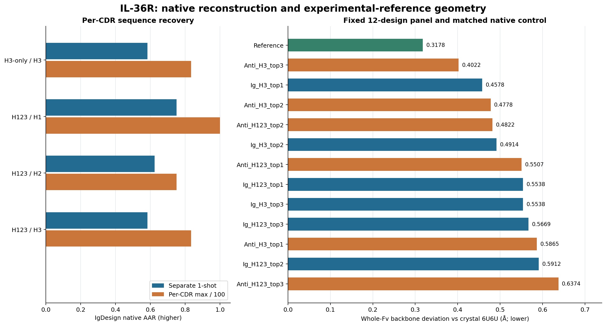
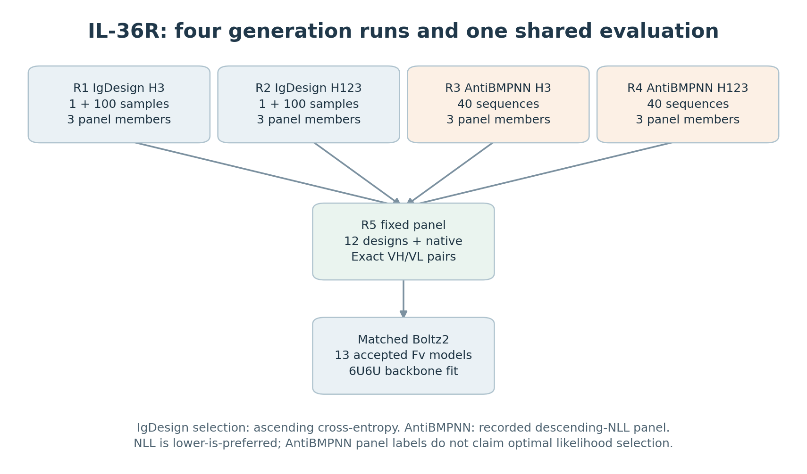

# IL-36R: benchmark comparison

Five completed runs compare Spesolimab CDR reconstruction and a fixed 12-design structural panel. IgDesign reaches maximum HCDR3 recovery of 0.8333 in each 100-sample scope. The lowest candidate Fv deviation from the experimental reference is `antibmpnn_hcdr3_top3` (0.4022 Å); the unmodified native control is 0.3178 Å.

## Completed workflows

| Completed run | Method and scope | Saved output |
| --- | --- | --- |
| `run_001_igdesign_hcdr3_native_reconstruction` | IgDesign HCDR3-only reconstruction | 1-shot + 100-sample pool; 101 samples; 3 selected panel members |
| `run_002_igdesign_hcdr123_native_reconstruction` | IgDesign HCDR123 reconstruction | 1-shot + 100-sample pool; 101 samples; 3 selected panel members |
| `run_003_antibmpnn_hcdr3_redesign` | AntiBMPNN HCDR3-only redesign | 40 generated sequences; 3 recorded panel members |
| `run_004_antibmpnn_hcdr123_redesign` | AntiBMPNN HCDR123 redesign | 40 generated sequences; 3 recorded panel members |
| `run_005_boltz2_fv_structural_consistency` | Matched Boltz2 Fv structural evaluation | 12 fixed candidate sequences + 1 unmodified reference; 13 accepted models |

The last run evaluates candidates from the first four runs. It does not generate additional sequences. All candidates preserve the native VL and VH framework.

## Native-sequence recovery

| IgDesign scope | Sampling rule | Samples | HCDR1 AAR ↑ | HCDR2 AAR ↑ | HCDR3 AAR ↑ |
| --- | --- | --- | --- | --- | --- |
| HCDR3 | 1-shot | 1 | — | — | 0.5833 |
| HCDR3 | Per-CDR maximum over 100 | 100 | — | — | 0.8333 |
| HCDR123 | 1-shot | 1 | 0.7500 | 0.6250 | 0.5833 |
| HCDR123 | Per-CDR maximum over 100 | 100 | 1.0000 | 0.7500 | 0.8333 |

The editable VH positions are 26–33, 51–58 and 97–108. The 100-sample row reports each CDR's own maximum; the HCDR123 values 1.0000/0.7500/0.8333 need not belong to a single sequence. Recovery describes sequence reconstruction and is separate from the predictor evaluation below.

## Structural evaluation

The comparator is the prepared experimental 6U6U Fv (VH 119 residues, VL 108). All measurements use backbone N, Cα, C and O atoms after one Kabsch fit on VH and VL framework residues. The fit excludes VH CDRs and VL positions 24–34, 50–56 and 89–97; each region is measured in that common frame without refitting.

| Rank by Fv | Candidate | HCDR3 (Å) ↓ | HCDR123 (Å) ↓ | Fv (Å) ↓ | VH pLDDT (0–100) ↑ |
| --- | --- | --- | --- | --- | --- |
| 1 | `antibmpnn_hcdr3_top3` | 0.7288 | 0.6722 | 0.4022 | 96.41 |
| 2 | `igdesign_hcdr3_top1` | 0.7846 | 0.7970 | 0.4578 | 97.72 |
| 3 | `antibmpnn_hcdr3_top2` | 0.7853 | 0.7756 | 0.4778 | 96.68 |
| 4 | `antibmpnn_hcdr123_top2` | 1.1687 | 0.9794 | 0.4822 | 96.74 |
| 5 | `igdesign_hcdr3_top2` | 0.8909 | 0.9037 | 0.4914 | 97.68 |
| 6 | `antibmpnn_hcdr123_top1` | 1.6640 | 1.2648 | 0.5507 | 97.07 |
| 7 | `igdesign_hcdr123_top1` | 1.0304 | 0.9334 | 0.5538 | 98.15 |
| 8 | `igdesign_hcdr3_top3` | 1.4588 | 1.1483 | 0.5538 | 97.58 |
| 9 | `igdesign_hcdr123_top3` | 0.9898 | 1.0277 | 0.5669 | 98.57 |
| 10 | `antibmpnn_hcdr3_top1` | 1.7788 | 1.3178 | 0.5865 | 96.54 |
| 11 | `igdesign_hcdr123_top2` | 0.6926 | 0.7700 | 0.5912 | 97.88 |
| 12 | `antibmpnn_hcdr123_top3` | 1.7285 | 1.3969 | 0.6374 | 97.01 |

The same-protocol native control gives HCDR3 0.3713 Å, HCDR123 0.4300 Å and Fv 0.3178 Å. The identifiers retain the recorded panel order. IgDesign panel members were selected by ascending cross-entropy loss. AntiBMPNN panel members were selected in descending reported score order; that score is a negative log likelihood, for which lower is preferred. The AntiBMPNN labels therefore identify this fixed evaluated panel and do not claim the best-likelihood sequences from the generation pool.

## Benchmark interpretation

All 12 designs have larger whole-Fv deviation than the matched native control. `antibmpnn_hcdr3_top3` is closest on whole Fv, while `igdesign_hcdr123_top2` has the lowest candidate HCDR3 deviation (0.6926 Å). The candidates span Fv deviation 0.4022–0.6374 Å and VH pLDDT 96.41–98.57. High predicted confidence does not imply native sequence recovery or improved binding.

The released native-control Fv values span 0.3777–1.1768 Å across ABB2, ABB3, ABB3-LM and ESMFold. Their predictor and evaluation protocols differ from this Boltz2 backbone-atom calculation. They are reference context, not evidence of a head-to-head method improvement. Candidate binding affinity was not measured.

## Figures

Left: IgDesign per-CDR native AAR (0–1, higher), with separate 1-shot samples and per-CDR maxima over 100 samples. Right: whole-Fv backbone deviation (Å, lower) for the 12 fixed candidates and matched native control, measured against experimental 6U6U.

Four generation runs yield 202 IgDesign samples and 80 AntiBMPNN sequences. Three recorded panel members per route plus the native reference enter one shared Boltz2 evaluation, giving 13 accepted Fv models.

## Saved evidence

- `run_001_igdesign_hcdr3_native_reconstruction`: [metrics](../../../results/task_015_il36r_igdesign_cdr_redesign/run_001_igdesign_hcdr3_native_reconstruction/metrics.csv), [shortlist](../../../results/task_015_il36r_igdesign_cdr_redesign/run_001_igdesign_hcdr3_native_reconstruction/shortlist.csv), [report](../../../results/task_015_il36r_igdesign_cdr_redesign/run_001_igdesign_hcdr3_native_reconstruction/report.md).
- `run_002_igdesign_hcdr123_native_reconstruction`: [metrics](../../../results/task_015_il36r_igdesign_cdr_redesign/run_002_igdesign_hcdr123_native_reconstruction/metrics.csv), [shortlist](../../../results/task_015_il36r_igdesign_cdr_redesign/run_002_igdesign_hcdr123_native_reconstruction/shortlist.csv), [report](../../../results/task_015_il36r_igdesign_cdr_redesign/run_002_igdesign_hcdr123_native_reconstruction/report.md).
- `run_003_antibmpnn_hcdr3_redesign`: [metrics](../../../results/task_015_il36r_igdesign_cdr_redesign/run_003_antibmpnn_hcdr3_redesign/metrics.csv), [shortlist](../../../results/task_015_il36r_igdesign_cdr_redesign/run_003_antibmpnn_hcdr3_redesign/shortlist.csv), [report](../../../results/task_015_il36r_igdesign_cdr_redesign/run_003_antibmpnn_hcdr3_redesign/report.md).
- `run_004_antibmpnn_hcdr123_redesign`: [metrics](../../../results/task_015_il36r_igdesign_cdr_redesign/run_004_antibmpnn_hcdr123_redesign/metrics.csv), [shortlist](../../../results/task_015_il36r_igdesign_cdr_redesign/run_004_antibmpnn_hcdr123_redesign/shortlist.csv), [report](../../../results/task_015_il36r_igdesign_cdr_redesign/run_004_antibmpnn_hcdr123_redesign/report.md).
- `run_005_boltz2_fv_structural_consistency`: [metrics](../../../results/task_015_il36r_igdesign_cdr_redesign/run_005_boltz2_fv_structural_consistency/metrics.csv), [shortlist](../../../results/task_015_il36r_igdesign_cdr_redesign/run_005_boltz2_fv_structural_consistency/shortlist.csv), [report](../../../results/task_015_il36r_igdesign_cdr_redesign/run_005_boltz2_fv_structural_consistency/report.md).

[Published reference and metric definitions](reference.md).
