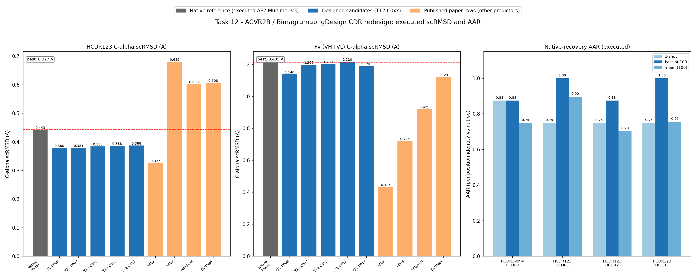
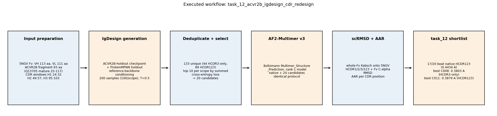

# ACVR2B / Bimagrumab — workflow comparison

Twenty selected candidates were assessed from 200 generated samples and 133 unique designs. The comparison uses the same AlphaFold2-Multimer v3 procedure for the native Bimagrumab control and the candidates. **T12-C008** (HCDR3-only) leads HCDR2, HCDR3, HCDR123 and Fv scRMSD, and **T12-C011** (HCDR123) is the best three-CDR redesign.

## Completed workflow

| Run | Generator | Generated / unique | Evaluated |
| --- | --- | --- | --- |
| run_001_igdesign_hcdr_redesign | IgDesign (ACVR2B-holdout + ProteinMPNN) | 200 / 133 | 20 candidates + native control |

## Candidate comparison against the matched control

Bold scores are favorable to the control in that column. Values are C-alpha scRMSD (A) after whole-Fv Kabsch alignment onto 5NGV; lower is better.

| Candidate | HCDR1 | HCDR2 | HCDR3 | HCDR123 | Fv |
| --- | ---: | ---: | ---: | ---: | ---: |
| REFERENCE | **0.2347** | 0.6304 | 0.3705 | 0.4434 | 1.2140 |
| T12-C008 | 0.2601 | 0.5014 | **0.3387** | **0.3803** | **1.1399** |
| T12-C007 | 0.2968 | **0.4800** | 0.3405 | 0.3805 | 1.1999 |
| T12-C001 | 0.2466 | 0.5052 | 0.3585 | 0.3849 | 1.2033 |
| T12-C011 | 0.2430 | 0.5191 | 0.3506 | 0.3879 | 1.2199 |
| T12-C017 | 0.2428 | 0.5077 | 0.3681 | 0.3883 | 1.1901 |

The saved shortlist retains these top five, ranked by HCDR123 scRMSD; the complete twenty-candidate run is archived separately. Across all twenty evaluated candidates, seventeen beat the native HCDR123 scRMSD (0.4434 A), with Fv scRMSD spanning 1.13–1.24 A (native 1.2140 A).

## Metric leaders

| Criterion | Candidate | Candidate value | Control value | Candidate − control |
| --- | --- | ---: | ---: | ---: |
| HCDR123 scRMSD | **T12-C008** | 0.3803 | 0.4434 | **−0.0631** |
| Best HCDR123-scope redesign | **T12-C011** | 0.3879 | 0.4434 | **−0.0555** |
| Fv scRMSD | **T12-C008** | 1.1399 | 1.2140 | **−0.0741** |

Native-recovery AAR (executed; 1-shot / best-of-100 / mean over 100): HCDR3-only HCDR3 0.875 / 0.875 / 0.750; HCDR123 HCDR1 0.750 / 1.000 / 0.897, HCDR2 0.750 / 0.875 / 0.703, HCDR3 0.750 / 1.000 / 0.757.

## Benchmark interpretation

The published benchmark reports native-reference scRMSD for ABB2, ABB3, ABB3-LM and ESMFold. Those use different structure predictors than the executed AlphaFold2-Multimer v3 and are retained side-by-side, not as a like-for-like comparison. The highlighted gains are therefore gains against the **predicted native Bimagrumab control** under the same predictor. The like-for-like comparison is candidate versus native within the executed predictor.

## Results figures

**Results chart.** The panels compare candidate HCDR123 and Fv C-alpha scRMSD against the executed native control and the published benchmark rows, and report native-recovery AAR by CDR. Dashed lines mark the executed native control.

**Workflow diagram.** The diagram connects input preparation, IgDesign generation, deduplication and selection, matched AlphaFold2-Multimer v3 prediction and the final scRMSD/AAR evaluation into the task_12 shortlist.

## Saved evidence

[run_001_igdesign_hcdr_redesign: metrics](../Results/task_12_acvr2b_igdesign_cdr_redesign/run_001_igdesign_hcdr_redesign/metrics.csv) · [run_001_igdesign_hcdr_redesign: shortlist](../Results/task_12_acvr2b_igdesign_cdr_redesign/run_001_igdesign_hcdr_redesign/shortlist.csv) · [run_001_igdesign_hcdr_redesign: report](../Results/task_12_acvr2b_igdesign_cdr_redesign/run_001_igdesign_hcdr_redesign/report.md). [Published reference](reference.md).
