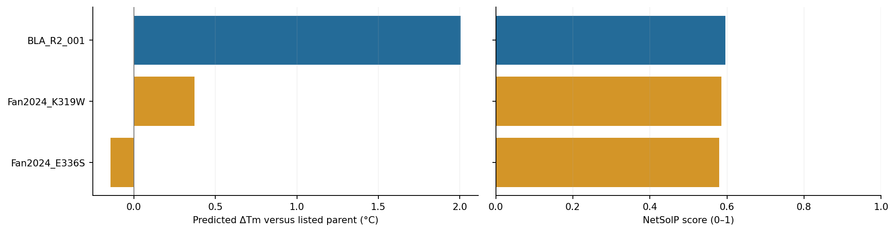
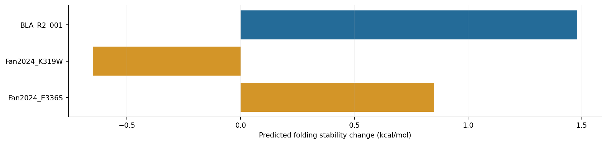
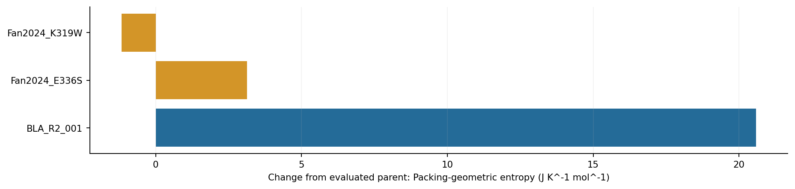

# BLA high-temperature performance — benchmark report

Agent-alone candidates, published prediction values and reference variants calculated in this work.

Agent Scientist: gpt-6.1-sol. Predictor names and units are listed with each measurement.

## Published predictions and our predictions

| Property / predictor | Published prediction | Our candidates |
| --- | --- | --- |
| FoldX stability-change prediction (paper reports kJ/mol) | K319W −1.72 ± 0.08; E336S −1.26 ± 0.11 | EvoEF1: BLA_R2_001 +1.48 kcal/mol; matched reference recalculations below. |
| MD-prepared packing entropy (J K−1 mol−1) | WT 4601; K319W 4614; E336S 4609 | Static PACKMAN: BLA_R2_001 7169.33; matched reference recalculations below. |

Source: [Fan et al., computational screening](https://pmc.ncbi.nlm.nih.gov/articles/PMC10883975/).

## Property predictions calculated in this work

| Sequence | Group | Parent / background | Predicted Tm (°C) | ΔTm (°C) | NetSolP | pHPred (raw) |
| --- | --- | --- | --- | --- | --- | --- |
| BLA_R2_001 | Our candidate | BLA_PARENT_WP061576039_mature30_512 | 52.7676 | 2.0042 | 0.595761 | 7.3500 |
| Fan2024_K319W | Reference | BLA_PARENT_WP061576039_mature30_512 | 51.1367 | 0.3734 | 0.585213 | 7.3357 |
| Fan2024_E336S | Reference | BLA_PARENT_WP061576039_mature30_512 | 50.6193 | -0.1441 | 0.580433 | 7.3357 |

### Candidate and reference property predictions

Blue: our candidates. Amber: reference variants calculated in this work. Changes use the parents listed in the table.

## Predicted folding stability change — open-source assessment

Method: EvoEF1 1.1. Units: kcal/mol. Protocol: common WT; protein-only; 3 repair runs; 10 matched WT/mutant repacking runs; negative predicts stabilization. Values below were calculated in this work for the listed sequences.

| Sequence | Group | Parent / background | Prediction (kcal/mol) |
| --- | --- | --- | --- |
| BLA_R2_001 | Our candidate | BLA_PARENT_WP061576039_mature30_512 | 1.48 |
| Fan2024_K319W | Reported reference | BLA_PARENT_WP061576039_mature30_512 | -0.65 |
| Fan2024_E336S | Reported reference | BLA_PARENT_WP061576039_mature30_512 | 0.85 |

### Predicted folding stability change: reference and our sequences

Amber: reported reference variants recalculated here. Blue: our retained candidates. All rows in this panel use the stated method and protocol.

## Packing-geometric entropy — open-source assessment

Method: PACKMAN 1.4.13. Units: J K^-1 mol^-1. Protocol: matched fixed backbone; deterministic FASPR all-sidechain packing; 1.4 A probe; 30 sphere points; protein heavy atoms. Values below were calculated in this work for the listed sequences.

| Sequence | Group | Parent / background | Prediction (J K^-1 mol^-1) | Change from parent (J K^-1 mol^-1) |
| --- | --- | --- | --- | --- |
| Fan2024_K319W | Reported reference | BLA_PARENT_WP061576039_mature30_512 | 7147.58 | -1.16801 |
| Fan2024_E336S | Reported reference | BLA_PARENT_WP061576039_mature30_512 | 7151.87 | +3.12413 |
| BLA_R2_001 | Our candidate | BLA_PARENT_WP061576039_mature30_512 | 7169.33 | +20.5858 |

### Packing-geometric entropy: reference and our sequences

Amber: reported reference variants recalculated here. Blue: our retained candidates. All rows in this panel use the stated method and protocol. The plot shows changes from the evaluated parent.

[Results and preparation details](../../../../results/task_003_bla_high_temperature/20261112_181250_7cf059/README.md) · [Published reference](../../../reference_data/task_003_bla_high_temperature/references.md).
