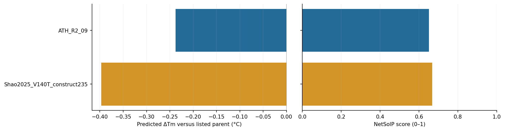
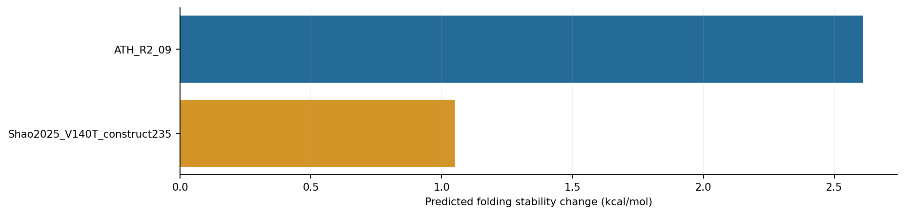
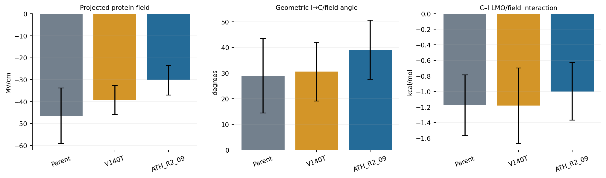

# AtHOL1 substrate expansion — benchmark report

Agent-alone candidates, published prediction values and reference variants calculated in this work.

Agent Scientist: gpt-6.1-sol. Predictor names and units are listed with each measurement.

## Published predictions and our predictions

| Property / predictor | Published prediction | Our candidates |
| --- | --- | --- |
| Named electrostatic stabilization estimate (kcal/mol) | WT −5.6; V140T −7.8 (main text) | Our separate pre-reaction LMO interaction: parent −1.18; V140T −1.18; ATH_R2_09 −1.00. Distinct method/estimate. |
| Projected protein field (MV/cm) | WT −35.2 ± 9.6; V140T −43.4 ± 5.7 | 30 ns protocol: parent −46.42 ± 12.68; V140T −39.24 ± 6.56; ATH_R2_09 −30.28 ± 6.75 |
| Mean geometric I→C/field angle (degrees) | WT 41.2; V140T 16.6 | 30 ns protocol: parent 28.97; V140T 30.54; ATH_R2_09 39.10 |

Source: [Shao et al., Figure 8A and electrostatic analysis](https://pmc.ncbi.nlm.nih.gov/articles/PMC12288847/).

## Property predictions calculated in this work

| Sequence | Group | Parent / background | Predicted Tm (°C) | ΔTm (°C) | NetSolP | pHPred (raw) |
| --- | --- | --- | --- | --- | --- | --- |
| ATH_R2_09 | Our candidate | AtHOL1_3LCC_construct235 | 47.1996 | -0.2375 | 0.651168 | 7.0714 |
| Shao2025_V140T_construct235 | Reference | AtHOL1_3LCC_construct235 | 47.0402 | -0.3969 | 0.667472 | 7.0286 |

### Candidate and reference property predictions

Blue: our candidates. Amber: reference variants calculated in this work. Changes use the parents listed in the table.

## Predicted folding stability change — open-source assessment

Method: EvoEF1 1.1. Units: kcal/mol. Protocol: common WT; protein-only; 3 repair runs; 10 matched WT/mutant repacking runs; negative predicts stabilization. Values below were calculated in this work for the listed sequences.

| Sequence | Group | Parent / background | Prediction (kcal/mol) |
| --- | --- | --- | --- |
| ATH_R2_09 | Our candidate | AtHOL1_3LCC_construct235 | 2.61 |
| Shao2025_V140T_construct235 | Reported reference | AtHOL1_3LCC_construct235 | 1.05 |

### Predicted folding stability change: reference and our sequences

Amber: reported reference variants recalculated here. Blue: our retained candidates. All rows in this panel use the stated method and protocol.

## Matched 30 ns reaction-site assessment

Each sequence has one 30 ns trajectory; the first 5 ns are excluded. Field and angle summaries use 250 snapshots; explicit C–I LMO calculations use 25 snapshots per sequence. Values are mean ± sample SD.

| Observable | Parent | Reference V140T | Our ATH_R2_09 |
| --- | --- | --- | --- |
| Projected protein field (MV/cm) | -46.42 ± 12.68 | -39.24 ± 6.56 | -30.28 ± 6.75 |
| Geometric I→C/field angle (degrees) | 28.97 ± 14.58 | 30.54 ± 11.43 | 39.10 ± 11.48 |
| C–I LMO/field interaction (kcal/mol) | -1.18 ± 0.39 | -1.18 ± 0.49 | -1.00 ± 0.37 |

### Matched field, geometry and interaction predictions

Error bars show sample SD along a single trajectory, not independent experimental uncertainty. Only calculations from our declared 30 ns protocol share these axes.

The candidate field is less negative than the evaluated parent. Its mean interaction change is +0.177 kcal/mol; the conditional temporal-block interval [−0.124, +0.478] includes zero. This assessment does not resolve an interaction improvement. The LMO interaction is a pre-reaction coupling estimate, not an activation barrier or a measured activity.

[Protocol and sequence identities](../../../../results/task_004_athol1_substrate/run_001_20261112_181250_0bd28c/steps/10_reaction_electrostatics/README.md).

[Results and preparation details](../../../../results/task_004_athol1_substrate/run_001_20261112_181250_0bd28c/README.md) · [Published reference](../../../reference_data/task_004_athol1_substrate/references.md).
