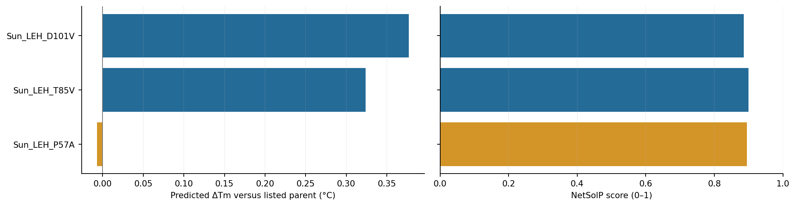
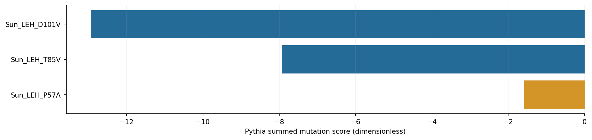
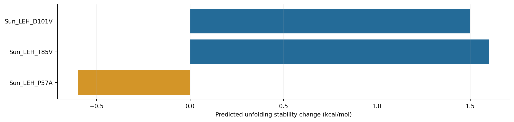

# Sun LEH / Pythia reproduction — benchmark report

Agent-alone candidates, published prediction values and reference variants calculated in this work.

Agent Scientist: gpt-6.1-sol. Predictor names and units are listed with each measurement.

## Published predictions and our predictions

| Property / predictor | Published prediction | Our candidates |
| --- | --- | --- |
| Pythia score (unitless) | Candidate score not reported | D101V −12.93692160; T85V −7.93473864 (summed score) |
| Pythia selection cutoff | < −2 | 33 selected mutations using summed-score implementation |
| Predicted Tm change (°C) | Not reported | D101V +0.3770; T85V +0.3236 |

Source: [Sun et al., LEH case study](https://pmc.ncbi.nlm.nih.gov/articles/PMC11763918/).

## Property predictions calculated in this work

| Sequence | Group | Parent / background | Predicted Tm (°C) | ΔTm (°C) | NetSolP | pHPred (raw) |
| --- | --- | --- | --- | --- | --- | --- |
| Sun_LEH_D101V | Our candidate | LEH_WT | 52.5597 | 0.3770 | 0.886254 | 7.3929 |
| Sun_LEH_T85V | Our candidate | LEH_WT | 52.5063 | 0.3236 | 0.899697 | 7.4071 |
| Sun_LEH_P57A | Reference | LEH_WT | 52.1758 | -0.0069 | 0.895321 | 7.3857 |

### Candidate and reference property predictions

Blue: our candidates. Amber: reference variants calculated in this work. Changes use the parents listed in the table.

## Pythia summed mutation score — open-source assessment

Method: Pythia C+P. Units: dimensionless. Protocol: 1NWW chain A; negative log mutant/parent ratio; fixed source and checkpoints. Values below were calculated in this work for the listed sequences.

| Sequence | Group | Parent / background | Prediction (dimensionless) |
| --- | --- | --- | --- |
| Sun_LEH_D101V | Our candidate | LEH_WT | -12.9369 |
| Sun_LEH_T85V | Our candidate | LEH_WT | -7.93474 |
| Sun_LEH_P57A | Reported reference | LEH_WT | -1.58501 |

### Pythia summed mutation score: reference and our sequences

Amber: reported reference variants recalculated here. Blue: our retained candidates. All rows in this panel use the stated method and protocol.

## Predicted unfolding stability change — open-source assessment

Method: DDGun SEQ. Units: kcal/mol. Protocol: sequence-based complete variant; positive predicts stabilization; compatible completed outputs reused. Values below were calculated in this work for the listed sequences.

| Sequence | Group | Parent / background | Prediction (kcal/mol) |
| --- | --- | --- | --- |
| Sun_LEH_D101V | Our candidate | LEH_WT | 1.5 |
| Sun_LEH_T85V | Our candidate | LEH_WT | 1.6 |
| Sun_LEH_P57A | Reported reference | LEH_WT | -0.6 |

### Predicted unfolding stability change: reference and our sequences

Amber: reported reference variants recalculated here. Blue: our retained candidates. All rows in this panel use the stated method and protocol.

[Results and preparation details](../../../../results/task_005_sun_leh_pythia/run_002_20261106_185928_f4aa65/README.md) · [Published reference](../../../reference_data/task_005_sun_leh_pythia/references.md).
