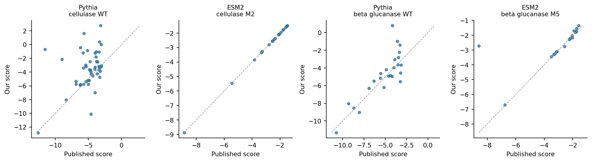
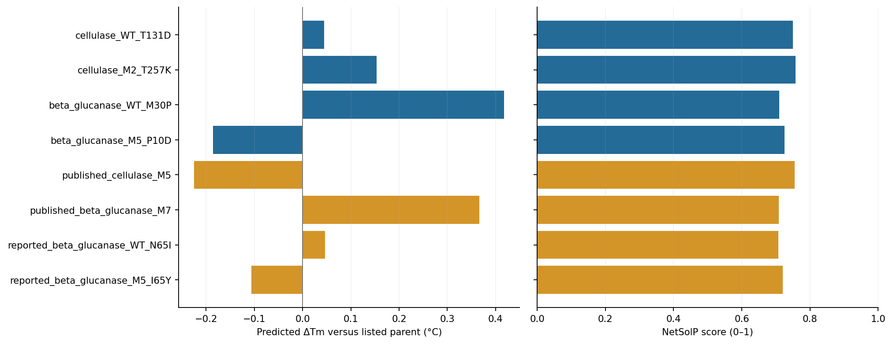
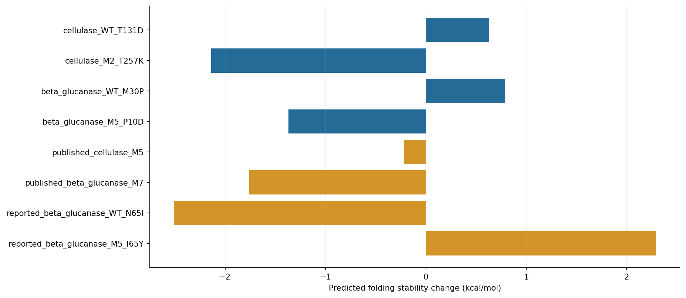

# Zhang cellulase and β-glucanase reproduction — benchmark report

Agent-alone candidates, published prediction values and reference variants calculated in this work.

Agent Scientist: gpt-6.1-sol. Predictor names and units are listed with each measurement.

## Published predictions and our predictions

| Property / predictor | Published prediction | Our candidates |
| --- | --- | --- |
| Cellulase WT: Pythia (unitless) | T131D −12.587 | T131D −12.79070377 |
| Cellulase M2: ESM (unitless) | M2 + T257K −8.872 | M2 + T257K −8.87227321 |
| β-glucanase WT: Pythia (unitless) | N65I −10.762 | Same variant N65I −11.32239389; retained leader M30P −14.53135109 |
| β-glucanase M5: ESM (unitless) | M5 + I65Y −8.583; M5 + P10D −6.767 | Same I65Y −2.72094822; retained leader P10D −6.70656031 |

Source: [Zhang et al., original supplementary tables S1/S3/S5/S7](https://doi.org/10.1016/j.ijbiomac.2024.138274).

## Same-variant prediction comparison

| Background | Predictor | Mutation | Published score | Our score |
| --- | --- | --- | --- | --- |
| cellulase_WT | Pythia | T131D | -12.587 | -12.790703773498535 |
| cellulase_M2 | ESM2 | T257K | -8.872 | -8.872273206710815 |
| beta_glucanase_WT | Pythia | N65I | -10.762 | -11.322393894195557 |
| beta_glucanase_M5 | ESM2 | I65Y | -8.583 | -2.7209482192993164 |
| beta_glucanase_M5 | ESM2 | P10D | -6.767 | -6.70656031370163 |

| Predictor / background | Rows | Mean absolute difference | Rank correlation |
| --- | --- | --- | --- |
| Pythia / cellulase_WT | 47 | 2.030403 | 0.310130 |
| ESM2 / cellulase_M2 | 20 | 0.000221 | 0.999624 |
| Pythia / beta_glucanase_WT | 24 | 1.059948 | 0.744348 |
| ESM2 / beta_glucanase_M5 | 17 | 0.417425 | 0.917229 |

### Published versus recalculated scores

Each panel compares the same variants and scoring background. Scores are unitless; the dashed line marks equal values.

## Property predictions calculated in this work

| Sequence | Group | Parent / background | Predicted Tm (°C) | ΔTm (°C) | NetSolP | pHPred (raw) |
| --- | --- | --- | --- | --- | --- | --- |
| Zhang_cellulase_WT_T131D | Our candidate | Zhang_cellulase_WT | 47.2853 | 0.0444 | 0.750243 | 7.3643 |
| Zhang_cellulase_M2_T257K | Our candidate | Zhang_cellulase_M2 | 47.4771 | 0.1533 | 0.757610 | 7.3643 |
| Zhang_beta_glucanase_WT_M30P | Our candidate | Zhang_beta_glucanase_WT | 48.1294 | 0.4176 | 0.710361 | 7.1286 |
| Zhang_beta_glucanase_M5_P10D | Our candidate | Zhang_beta_glucanase_M5 | 47.1254 | -0.1853 | 0.725672 | 7.1286 |
| Zhang_published_cellulase_M5 | Reference | Zhang_cellulase_WT | 47.0161 | -0.2248 | 0.755299 | 7.3643 |
| Zhang_published_beta_glucanase_M7 | Reference | Zhang_beta_glucanase_WT | 48.0782 | 0.3664 | 0.708764 | 7.1286 |
| Zhang_reported_beta_glucanase_WT_N65I | Reference | Zhang_beta_glucanase_WT | 47.7586 | 0.0468 | 0.707348 | 7.1286 |
| Zhang_reported_beta_glucanase_M5_I65Y | Reference | Zhang_beta_glucanase_M5 | 47.2043 | -0.1065 | 0.719984 | 7.1143 |

### Candidate and reference property predictions

Blue: our candidates. Amber: reference variants calculated in this work. Changes use the parents listed in the table.

## Predicted folding stability change — open-source assessment

Method: EvoEF1 1.1. Units: kcal/mol. Protocol: common WT; protein-only; 3 repair runs; 10 matched WT/mutant repacking runs; negative predicts stabilization. Values below were calculated in this work for the listed sequences.

| Sequence | Group | Parent / background | Prediction (kcal/mol) |
| --- | --- | --- | --- |
| Zhang_cellulase_WT_T131D | Our candidate | Zhang_cellulase_WT | 0.63 |
| Zhang_cellulase_M2_T257K | Our candidate | Zhang_cellulase_WT | -2.14 |
| Zhang_beta_glucanase_WT_M30P | Our candidate | Zhang_beta_glucanase_WT | 0.79 |
| Zhang_beta_glucanase_M5_P10D | Our candidate | Zhang_beta_glucanase_WT | -1.37 |
| Zhang_published_cellulase_M5 | Reported reference | Zhang_cellulase_WT | -0.22 |
| Zhang_published_beta_glucanase_M7 | Reported reference | Zhang_beta_glucanase_WT | -1.76 |
| Zhang_reported_beta_glucanase_WT_N65I | Reported reference | Zhang_beta_glucanase_WT | -2.51 |
| Zhang_reported_beta_glucanase_M5_I65Y | Reported reference | Zhang_beta_glucanase_WT | 2.29 |

### Predicted folding stability change: reference and our sequences

Amber: reported reference variants recalculated here. Blue: our retained candidates. All rows in this panel use the stated method and protocol.

[Results and preparation details](../../../../results/task_006_zhang_hydrolases/run_002_20261107_144016_09fec4/README.md) · [Published reference](../../../reference_data/task_006_zhang_hydrolases/references.md).
