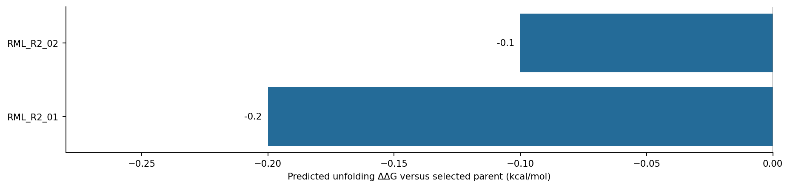
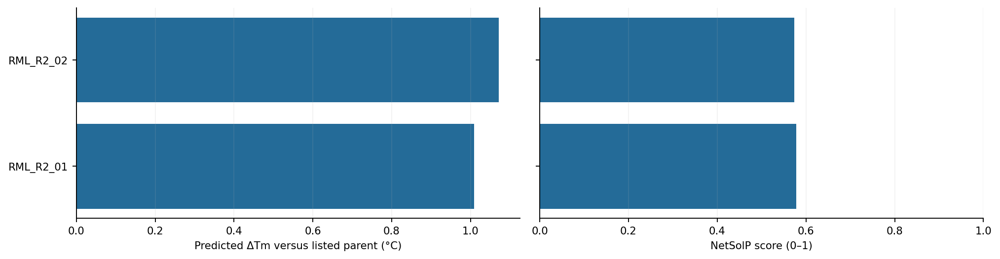

# RML stability — benchmark report

Agent-alone candidates, published prediction values and reference variants calculated in this work.

## Published predictions and our predictions

| Property / predictor | Published prediction | Our candidates |
| --- | --- | --- |
| Vina docking score, pNPL (kcal/mol) | WT −5.5; N120M/E230I/N264M −5.6 | RML_R2_01 −5.221; RML_R2_02 −5.193 |
| Folding-stability predictions | FoldX: N120M −0.35775; E230I −1.59876; N264M −0.77627 kcal/mol (single mutants). Additional Table 1 predictors in references. | DDGun_SEQ: RML_R2_02 −0.1; RML_R2_01 −0.2 kcal/mol ΔΔGunfold |
| Predicted Tm change (°C) | Not reported | RML_R2_02 +1.0722; RML_R2_01 +1.0096 |

Source: [Teng et al., Tables 1 and sections 3.4/3.7](https://pmc.ncbi.nlm.nih.gov/articles/PMC11727178/).

## Our stability predictions

| Candidate | Mutations | DDGun unfolding ΔΔG (kcal/mol) |
| --- | --- | --- |
| RML_R2_02 | S11Q,S71K,E72D,S135D,R160L,E161K,E162Q | -0.1 |
| RML_R2_01 | S11Q,S71K,E72T,S135D,R160L,E161K,E162Q | -0.2 |

Change is relative to our selected parent. Positive DDGun unfolding ΔΔG indicates predicted stabilization; negative indicates predicted destabilization.

### Stability change from our parent

All bars use DDGun_SEQ and the same selected parent within this task.

## Property predictions calculated in this work

| Sequence | Group | Parent / background | Predicted Tm (°C) | ΔTm (°C) | NetSolP | pHPred (raw) |
| --- | --- | --- | --- | --- | --- | --- |
| RML_R2_02 | Our candidate | RML_WT | 48.0504 | 1.0722 | 0.573641 | 6.9071 |
| RML_R2_01 | Our candidate | RML_WT | 47.9878 | 1.0096 | 0.577789 | 6.8929 |

### Candidate and reference property predictions

Blue: our candidates. Amber: reference variants calculated in this work. Changes use the parents listed in the table.

[Results and preparation details](../../../results/task_001_rml_stability/20261104_183717_92629f/README.md) · [Published reference](../references.md).
