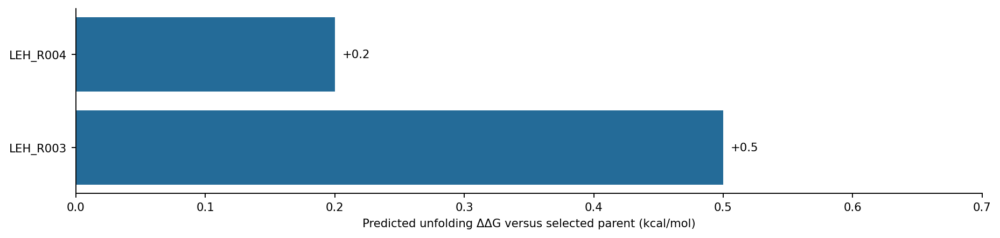
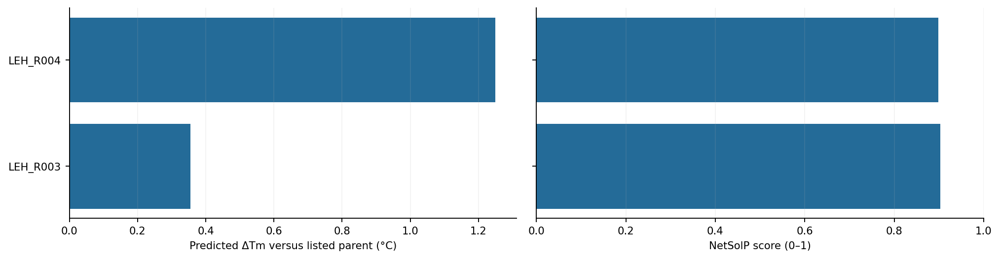

# LEH stability — benchmark report

Agent-alone candidates, published prediction values and reference variants calculated in this work.

## Published predictions and our predictions

| Property / predictor | Published prediction | Our candidates |
| --- | --- | --- |
| Predicted stability change | FoldX: T85I −20; T85V −14 kJ/mol ΔΔGfold | DDGun_SEQ: LEH_R004 +0.2; LEH_R003 +0.5 kcal/mol ΔΔGunfold |
| Predicted Tm change (°C) | Not reported | LEH_R004 +1.2498; LEH_R003 +0.3552 |

Source: [Wijma et al., Figure 1 and methods](https://pmc.ncbi.nlm.nih.gov/articles/PMC3893934/).

## Our stability predictions

| Candidate | Mutations | DDGun unfolding ΔΔG (kcal/mol) |
| --- | --- | --- |
| LEH_R004 | K42R,P107A,E124D | 0.2 |
| LEH_R003 | K42Y,P107A,E124D | 0.5 |

Change is relative to our selected parent. Positive DDGun unfolding ΔΔG indicates predicted stabilization; negative indicates predicted destabilization.

### Stability change from our parent

All bars use DDGun_SEQ and the same selected parent within this task.

## Property predictions calculated in this work

| Sequence | Group | Parent / background | Predicted Tm (°C) | ΔTm (°C) | NetSolP | pHPred (raw) |
| --- | --- | --- | --- | --- | --- | --- |
| LEH_R004 | Our candidate | LEH_WT | 53.4325 | 1.2498 | 0.898987 | 7.3929 |
| LEH_R003 | Our candidate | LEH_WT | 52.5379 | 0.3552 | 0.902987 | 7.3786 |

### Candidate and reference property predictions

Blue: our candidates. Amber: reference variants calculated in this work. Changes use the parents listed in the table.

[Results and preparation details](../../../results/task_002_leh_stability/20261104_183716_0fd35d/README.md) · [Published reference](../references.md).
