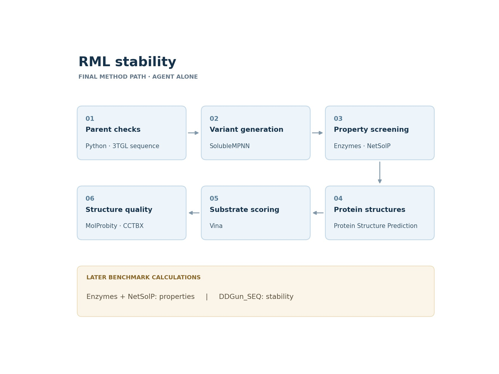

# RML stability — workflow

The diagram shows the final method path, with later benchmark calculations in a separate panel. Relevant screens and assessments were repeated after sequence revisions.

| Stage | Tools | Work performed | Results |
|---|---|---|---|
| Parent checks | Python | Freeze the 269-residue 3TGL parent and protected positions. | [Records](steps/01_parent_preparation/README.md) |
| Generation and revision | SolubleMPNN | Generate variants, then generate revised sequences after reviewing scores. | [Records](sequences/candidate_history.csv) |
| Property screening | Enzymes / TemBERTureTm; NetSolP | Compare temperature and solubility predictions for parent and variants. | [Records](steps/03_property_screening/outputs.csv) |
| Structures and substrate poses | Protein Structure Prediction; Vina | Build protein/complex models, propose poses and score retained substrate states. | [Records](steps/04_structure_and_chemical_assessment/outputs.csv) |
| Quality assessment | MolProbity; local CCTBX/OpenMM preparation | Measure structure quality and inspect prepared chemical states. | [Records](steps/04_structure_and_chemical_assessment/README.md) |

## Benchmark calculations

Later benchmark calculations used Enzymes (TemBERTureTm and raw pHPred), NetSolP and verified existing DDGun_SEQ outputs. RML_R2_02 and RML_R2_01 are the retained comparison sequences.

[Property comparison](reference_comparison/README.md)

[Outcome and qualification](OUTCOME.json) · [Sequences](sequences/identities.json) · [Usage and time](USAGE_AND_TIME.md)
