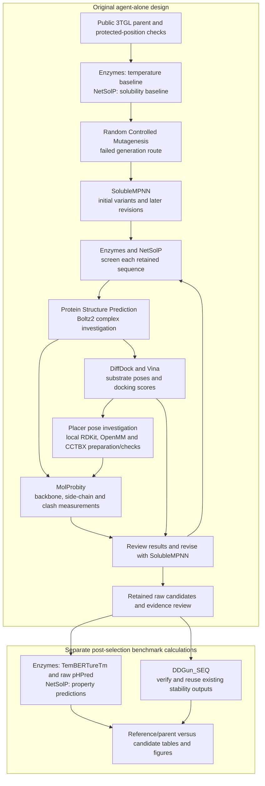

# RML stability — executed tools and workflow

The agent generated and revised variants of the 269-residue public 3TGL parent, screened temperature and solubility predictions, and investigated structure quality and substrate poses. RML_R2_02 and RML_R2_01 are retained for descriptive comparison; full scientific qualification remains unresolved.

## How to read this workflow

This is the recorded **agent-alone** workflow. Arrows show how outputs feed later steps; the revision loop reuses the screening and assessment tools. Failed attempts and incomplete assessments are labeled. Later reference calculations are shown separately because they did not guide the original candidate selection. No MLDE or specialist calls are part of these agent-alone runs.

## Whole workflow

## Steps and tools

| Step | Tools actually used | What happened and what was retained | Evidence |
|---|---|---|---|
| 1. Prepare the parent | Public 3TGL sequence; local Python identity/constraint checks | Fixed the 269-residue parent and protected positions before generation. | [Parent record](steps/01_parent_preparation/README.md) |
| 2. Establish baselines and generate variants | Enzymes (`tmPred_enzymes`), NetSolP; Random Controlled Mutagenesis → SolubleMPNN | Baselines supplied comparison values. The mutagenesis route failed; SolubleMPNN supplied initial and revised sequences. | [Generation](steps/02_variant_generation/README.md), [sequence history](sequences/candidate_history.csv) |
| 3. Screen sequences | Enzymes / TemBERTureTm; NetSolP | Compared predicted temperature and solubility with the same parent; kept full-precision scores for each round. | [Screen outputs](steps/03_property_screening/outputs.csv) |
| 4. Predict and inspect structures | Protein Structure Prediction; Boltz2; MolProbity | Predicted protein/complex states and measured structural quality. A returned structure or quality report was reviewed separately from functional acceptance. | [Structure and chemistry records](steps/04_structure_and_chemical_assessment/README.md) |
| 5. Investigate substrate poses and preparation | DiffDock; Vina basic docking and score-only mode; Placer; local RDKit, OpenMM and CCTBX-based checks | Inspected pNPL poses, docking scores and ligand/structure compatibility. Preparation failures, recovered measurements and conditional states were retained. These routes were investigations, not an automatic pass. | [Assessment outputs](steps/04_structure_and_chemical_assessment/outputs.csv), [execution index](steps/00_execution_index/jobs.csv) |
| 6. Revise and re-evaluate | SolubleMPNN; Enzymes; NetSolP; Protein Structure Prediction and the assessment tools above | Generated results-driven revisions, repeated relevant screens and assessments, then retained RML_R2_02 and RML_R2_01 for descriptive reporting. | [Revision outputs](steps/05_revision_and_re_evaluation/outputs.csv) |
| 7. Calculate later benchmark properties | Enzymes / TemBERTureTm and raw pHPred; NetSolP; DDGun_SEQ | Later property predictions use the exact retained sequences. Existing DDGun outputs were verified and reused rather than recalculated. RML comparisons use the selected parent; the paper's reference sequence was not reconstructed. | [Property comparison](reference_comparison/README.md), [DDGun records](steps/07_ddgun_stability/README.md) |

## Outcome

Operationally closed with limitations. The numerical predictions and evidence review are available; they do not establish a qualified improved enzyme. [Benchmark tables and figures](../../../benchmark/task_001_rml_stability/comparisions/benchmark_report.md).

## Records

- [Exact parent and candidate sequences](sequences/identities.json)
- [Recorded outcome](OUTCOME.json)
- [Model usage and time](USAGE_AND_TIME.md)
- [Published-reference and candidate property calculations](reference_comparison/README.md)
