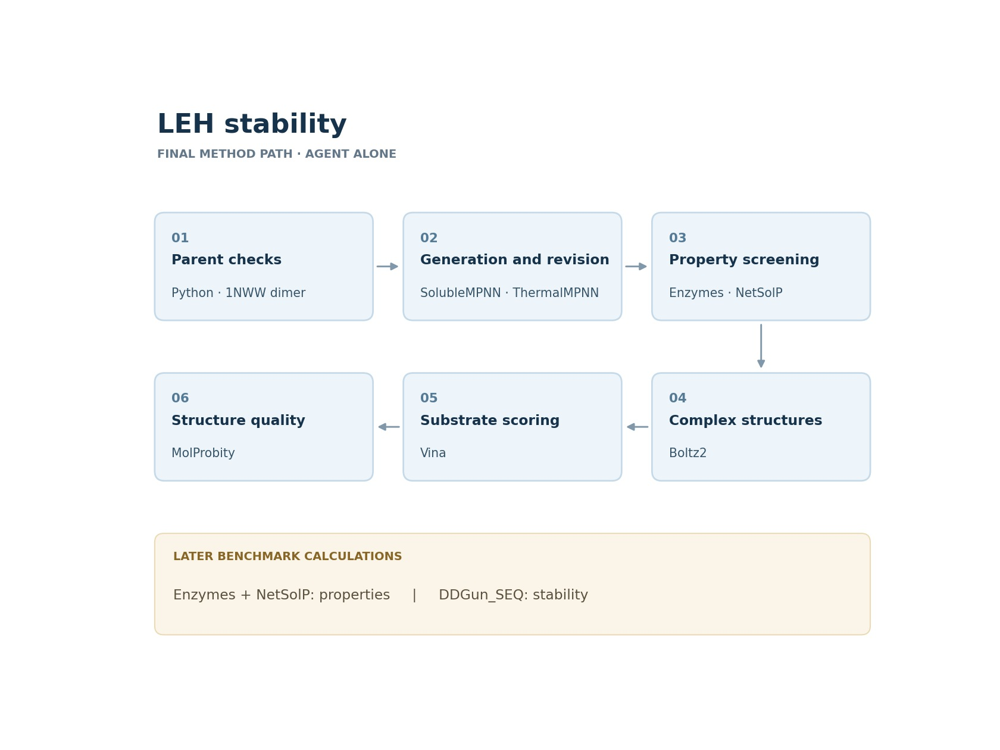

# LEH stability — workflow

The diagram shows the final method path, with later benchmark calculations in a separate panel. Relevant screens and assessments were repeated after sequence revisions.

| Stage | Tools | Work performed | Results |
|---|---|---|---|
| Parent checks | Python | Fix the 149-residue 1NWW/Q9ZAG3 sequence and biological dimer. | [Records](steps/01_parent_preparation/README.md) |
| Generation and revision | SolubleMPNN; ThermalMPNN | Generate variants and use mutation landscapes for subsequent revisions. | [Records](sequences/candidate_history.csv) |
| Property screening | Enzymes / TemBERTureTm; NetSolP | Screen parent and revised variants for predicted temperature and solubility. | [Records](steps/03_property_screening/outputs.csv) |
| Structures and substrate poses | Boltz2; Vina | Investigate dimer/joint-complex states and substrate poses. | [Records](steps/04_structure_and_chemical_assessment/outputs.csv) |
| Quality assessment | MolProbity; PDBFixer/OpenMM and ACPYPE preparation | Prepare chemical states and inspect geometry, hydrogen and polar-contact evidence. | [Records](steps/04_structure_and_chemical_assessment/README.md) |

## Benchmark calculations

Later benchmark calculations used Enzymes (TemBERTureTm and raw pHPred), NetSolP and verified existing DDGun_SEQ outputs. LEH_R004 and LEH_R003 are the retained raw comparison sequences.

[Property comparison](reference_comparison/README.md)

[Results and outcome](README.md) · [Sequences](sequences/identities.json) · [Usage and time](README.md#usage-and-time)
