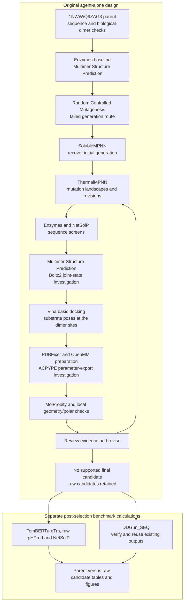

# LEH stability — executed tools and workflow

The agent used the 149-residue 1NWW/Q9ZAG3 enzyme and its biological dimer, generated variants, screened predicted properties, and assessed substrate-bound structures. LEH_R004 and LEH_R003 are retained as raw comparison candidates; no supported final candidate was selected.

## How to read this workflow

This is the recorded **agent-alone** workflow. Arrows show how outputs feed later steps; the revision loop reuses the screening and assessment tools. Failed attempts and incomplete assessments are labeled. Later reference calculations are shown separately because they did not guide the original candidate selection. No MLDE or specialist calls are part of these agent-alone runs.

## Whole workflow

## Steps and tools

| Step | Tools actually used | What happened and what was retained | Evidence |
|---|---|---|---|
| 1. Prepare the parent and baseline | Local sequence/structure checks; Enzymes; Multimer Structure Prediction | Fixed the native sequence and dimer identity; obtained the parent property baseline and initial dimer structure. | [Parent record](steps/01_parent_preparation/README.md), [execution index](steps/00_execution_index/jobs.csv) |
| 2. Generate variants and mutation options | Random Controlled Mutagenesis → SolubleMPNN; ThermalMPNN | The first generation route failed. SolubleMPNN recovered sequence generation; ThermalMPNN supplied mutation landscapes for further search and revision. | [Generation](steps/02_variant_generation/README.md), [sequence history](sequences/candidate_history.csv) |
| 3. Screen and rank sequences | Enzymes / TemBERTureTm; NetSolP | Predicted temperature and solubility for parent, initial variants and revised sequences. Scores guided further investigation. | [Screen outputs](steps/03_property_screening/outputs.csv) |
| 4. Build and assess substrate-bound states | Multimer Structure Prediction; Vina basic docking; Boltz2; MolProbity | Built dimer models, investigated substrate poses and later joint states, and measured structural quality. Apo measurements and complete-complex assessments remain distinct. | [Assessment outputs](steps/04_structure_and_chemical_assessment/outputs.csv) |
| 5. Investigate chemical preparation and recovery | PDBFixer; OpenMM; ACPYPE parameter-export route; local Python geometry/polar-contact analysis | Investigated terminal OXT atoms, hydrogen typing, ligand parameters and joint-state preparation. Successful preparation or a returned report did not by itself satisfy every chemical/function requirement. | [Assessment record](steps/04_structure_and_chemical_assessment/README.md), [attempt history](steps/00_execution_index/jobs.csv) |
| 6. Re-evaluate revisions and review evidence | ThermalMPNN; Enzymes; NetSolP; multimer/complex prediction, docking and MolProbity | Repeated relevant measurements after revisions. The review retained LEH_R004 and LEH_R003 as descriptive raw candidates, with no qualified final selection. | [Revision record](steps/05_revision_and_re_evaluation/README.md) |
| 7. Calculate later benchmark properties | Enzymes / TemBERTureTm and raw pHPred; NetSolP; DDGun_SEQ | Assessed exact retained sequences after original selection. Existing DDGun results were verified and reused. The original LEH comparison uses the selected parent. | [Property comparison](reference_comparison/README.md), [DDGun records](steps/07_ddgun_stability/README.md) |

## Outcome

Closed with no supported final candidate. Raw predictions remain available for comparison; the original structural acceptance requirement was not met. [Benchmark tables and figures](../../../benchmark/task_002_leh_stability/comparisions/benchmark_report.md).

## Records

- [Exact parent and candidate sequences](sequences/identities.json)
- [Recorded outcome](OUTCOME.json)
- [Model usage and time](USAGE_AND_TIME.md)
- [Published-reference and candidate property calculations](reference_comparison/README.md)
