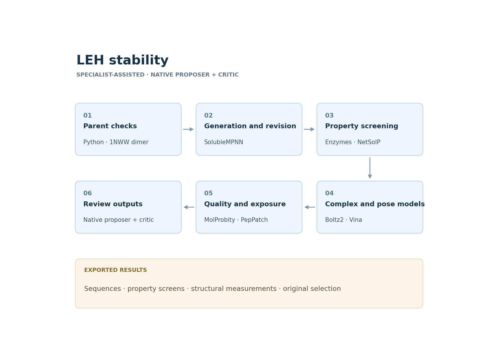

# LEH stability — specialist-assisted workflow

The native proposer and critic reviewed planning and result batches. The main agent executed scientific tools and retained the outputs.

| Stage | Tools | Work performed |
|---|---|---|
| Plan and input checks | Native proposer/critic; Python | Review the frozen public parent and constraints. |
| Generate and revise | SolubleMPNN | Generate sequence candidates and results-driven revisions. |
| Screen properties | Enzymes / TemBERTureTm; NetSolP | Retain matched parent/candidate temperature and solubility screens. |
| Assess structures and poses | Protein/multimer prediction; Boltz2; DiffDock; Vina | Investigate parent/candidate structures and substrate poses. |
| Assess chemistry and quality | MolProbity; PepPatch; local preparation/geometry analysis | Retain measured quality, polar/exposure and chemical-state evidence. |
| Review and close | Native proposer/critic and independent evidence review | Record the scientific outcome and original sealed selection without promoting raw scores to qualification. |

[Results and outcome](README.md) · [Sequences](sequences) · [Step outputs](steps)
