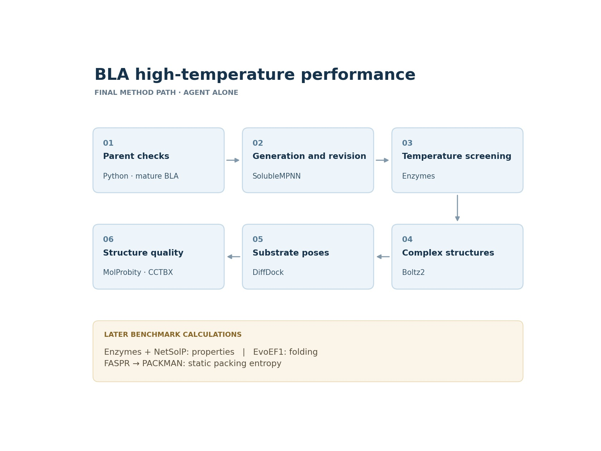

# BLA high-temperature performance — workflow

The diagram shows the final method path, with later benchmark calculations in a separate panel. Relevant screens and assessments were repeated after sequence revisions.

| Stage | Tools | Work performed | Results |
|---|---|---|---|
| Parent checks | Python; Protein Structure Prediction | Fix mature BLA residues 30–512 and prepare the parent model. | [Records](steps/01_parent_preparation/README.md) |
| Generation and revision | SolubleMPNN | Generate the initial variants and results-driven second-round sequences. | [Records](sequences/candidate_history.csv) |
| Property screening | Enzymes / TemBERTureTm; Peptiverse | Compare full-sequence temperature scores and a later secondary solubility screen. | [Records](steps/03_property_screening/outputs.csv) |
| Structures and poses | Boltz2; DiffDock | Model complexes and investigate alternative substrate poses. | [Records](steps/04_structure_and_chemical_assessment/outputs.csv) |
| Quality assessment | MolProbity / CCTBX; ProteinsPlus preparation | Measure available structure quality and investigate prepared parent/candidate states. | [Records](steps/04_structure_and_chemical_assessment/README.md) |

## Benchmark calculations

Later benchmark calculations used Enzymes and NetSolP for properties, EvoEF1 for folding stability, and FASPR → PACKMAN for static packing entropy. BLA_R2_001 is compared with reconstructed K319W/E336S references.

[Property comparison](reference_comparison/README.md)

[Outcome and qualification](OUTCOME.json) · [Sequences](sequences/identities.json) · [Usage and time](USAGE_AND_TIME.md)
