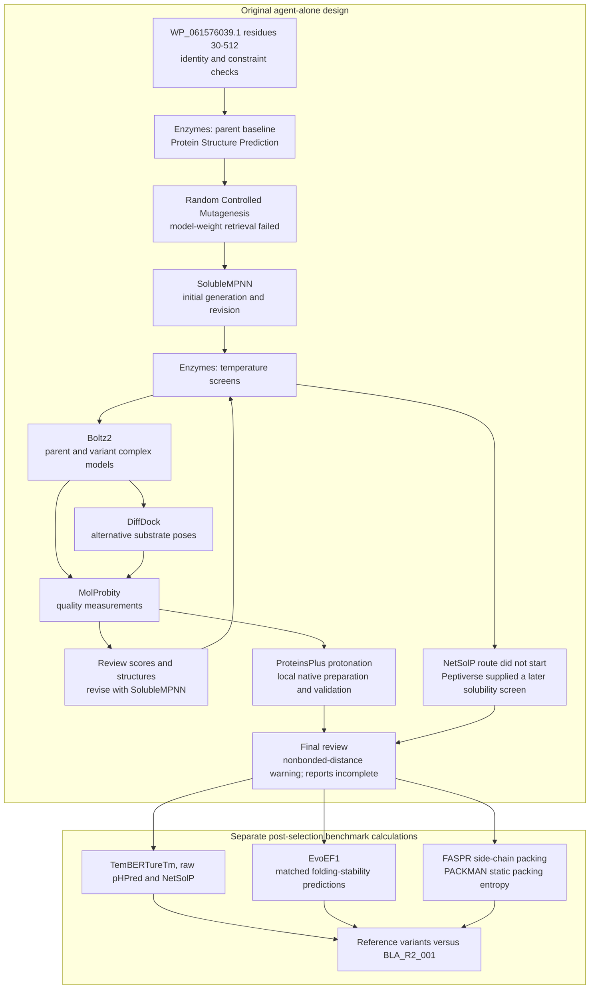

# BLA high-temperature performance — executed tools and workflow

The agent used the mature 483-residue BLA parent, generated eight variants across the recorded rounds, and assessed nine sequence identities including the parent. BLA_R2_001 is the retained raw temperature-score leader. The run closed with unresolved structural/chemical assessments.

## How to read this workflow

This is the recorded **agent-alone** workflow. Arrows show how outputs feed later steps; the revision loop reuses the screening and assessment tools. Failed attempts and incomplete assessments are labeled. Later reference calculations are shown separately because they did not guide the original candidate selection. No MLDE or specialist calls are part of these agent-alone runs.

## Whole workflow

## Steps and tools

| Step | Tools actually used | What happened and what was retained | Evidence |
|---|---|---|---|
| 1. Prepare and model the parent | Local sequence checks; Enzymes; Protein Structure Prediction; Boltz2 | Retained the 483-residue mature parent, recovered the initial temperature-screen route and investigated its substrate complex. | [Parent](steps/01_parent_preparation/README.md), [attempt index](steps/00_execution_index/jobs.json) |
| 2. Generate variants | Random Controlled Mutagenesis → SolubleMPNN | Model-weight retrieval blocked the first route. SolubleMPNN produced six unique initial variants from 12 draws; later revision added two variants. | [Generation](steps/02_variant_generation/README.md), [sequence history](sequences/candidate_history.csv) |
| 3. Screen full sequences | Enzymes / TemBERTureTm; attempted NetSolP; later Peptiverse | Temperature screens retained BLA_R2_001 as the raw leader. The original NetSolP route failed local preflight before execution; Peptiverse later returned a secondary solubility screen for all nine identities. Later shared NetSolP benchmark predictions are a separate calculation. | [Screen outputs](steps/03_property_screening/outputs.csv), [attempts 009 and 034](steps/00_execution_index/jobs.json) |
| 4. Assess complexes and alternative poses | Boltz2; MolProbity; DiffDock | Investigated predicted complexes, measured quality and tried alternative substrate poses. Returned measurements included partial or conditional scientific states. | [Assessment outputs](steps/04_structure_and_chemical_assessment/outputs.csv) |
| 5. Revise and re-score | SolubleMPNN; Enzymes; Boltz2; MolProbity | Re-evaluated second-round sequences and repeated candidate-specific assessments. The original selection and raw leader were preserved separately from qualification. | [Revision record](steps/05_revision_and_re_evaluation/README.md) |
| 6. Investigate preparation and complete available-output review | ProteinsPlus protonation; local native structure/ligand preparation and validation | The final record reached 81 scientific attempts. Final native validation reached topology and manager setup, then stopped on a very-small-nonbonded-distance warning. Required downstream reports remain incomplete; no candidate qualified. | [Recorded outcome](OUTCOME.json), [assessment record](steps/04_structure_and_chemical_assessment/README.md) |
| 7. Calculate later matched benchmark metrics | Enzymes / TemBERTureTm and raw pHPred; NetSolP; EvoEF1; FASPR → PACKMAN | Compared the retained candidate with reconstructed K319W/E336S reference variants. EvoEF1 supplies paired folding predictions; FASPR/PACKMAN supplies matched static packing entropy. These are post-selection comparisons. | [Property comparison](reference_comparison/README.md), [EvoEF protocol](reference_comparison/evoef/method.json), [PACKMAN protocol](reference_comparison/packman/method.json) |

## Outcome

Completed with unresolved blockers; no qualified finalist. The frozen primary endpoint retains its `native_score` label; provider temperature annotations and later benchmark temperature predictions retain their own definitions. [Benchmark tables and figures](../../../benchmark/task_003_bla_high_temperature/comparisions/benchmark_report.md).

## Records

- [Exact parent and candidate sequences](sequences/identities.json)
- [Recorded outcome](OUTCOME.json)
- [Model usage and time](USAGE_AND_TIME.md)
- [Published-reference and candidate property calculations](reference_comparison/README.md)
