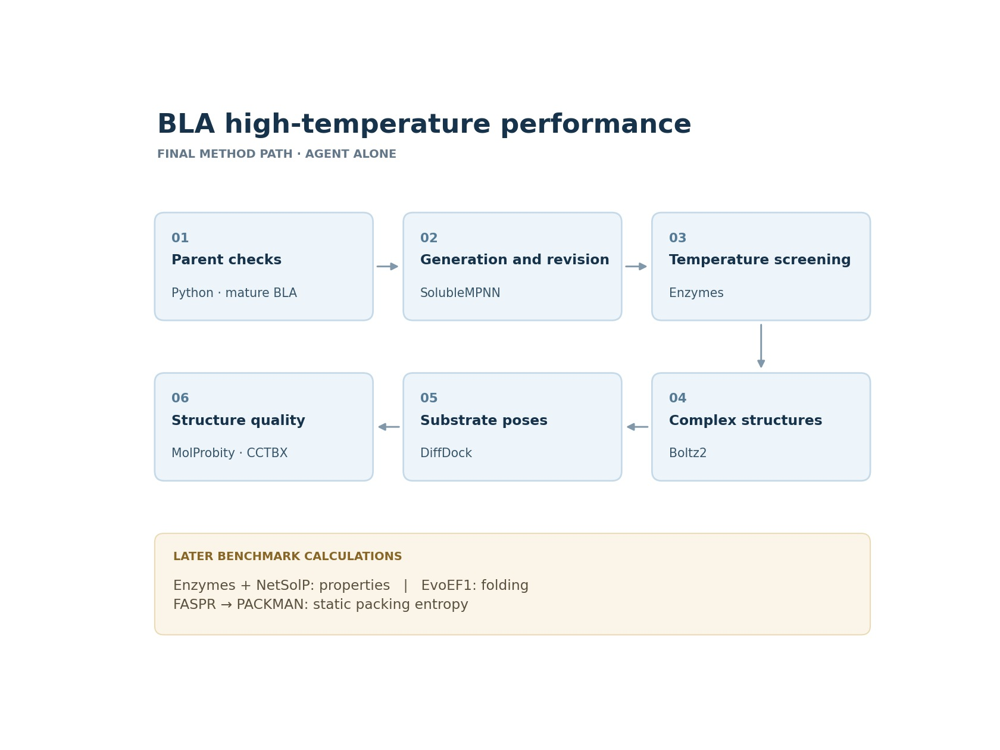

# BLA high-temperature performance — workflow

The diagram shows the final method path, with later benchmark calculations in a separate panel. Relevant screens and assessments were repeated after sequence revisions.

| Stage | Tools | Work performed | Results |
|---|---|---|---|
| Parent checks | Python; Protein Structure Prediction | Fix mature BLA residues 30–512 and prepare the parent model. | [Records](steps/01_parent_preparation/README.md) |
| Generation and revision | SolubleMPNN | Generate the initial variants and results-driven second-round sequences. | [Records](sequences/sha256-78d487ce56d5def66699a1d366709d450f63c70f4fbfe9ec4de81aba4f455606-22c94851_unreported_unreported_7cf059_unreported_unreported.csv) |
| Property screening | Enzymes / TemBERTureTm; Peptiverse | Compare full-sequence temperature scores and a later secondary solubility screen. | [Records](steps/03_property_screening/sha256-469fd1d2e6bbb7550d8ae646139af99b2c0e1d12eeb4518ec4ae4d7280e27ad9-7c944909_unreported_unreported_7cf059_unreported_unreported.csv) |
| Structures and poses | Boltz2; DiffDock | Model complexes and investigate alternative substrate poses. | [Records](steps/04_structure_and_chemical_assessment/sha256-2c7f1affc266d73c87b06d70a7cb115d7c4a0ef228da6e9c5d9b5d6f0f6c64d3-7c0b819f_unreported_unreported_7cf059_unreported_unreported.csv) |
| Quality assessment | MolProbity / CCTBX; ProteinsPlus preparation | Measure available structure quality and investigate prepared parent/candidate states. | [Records](steps/04_structure_and_chemical_assessment/README.md) |

## Benchmark calculations

Later benchmark calculations used Enzymes and NetSolP for properties, EvoEF1 for folding stability, and FASPR → PACKMAN for static packing entropy. BLA_R2_001 is compared with reconstructed K319W/E336S references.

[Property comparison](reference_comparison/README.md)

[Results and outcome](README.md) · [Sequences](sequences/identities.json) · [Usage and time](README.md#usage-and-time)
