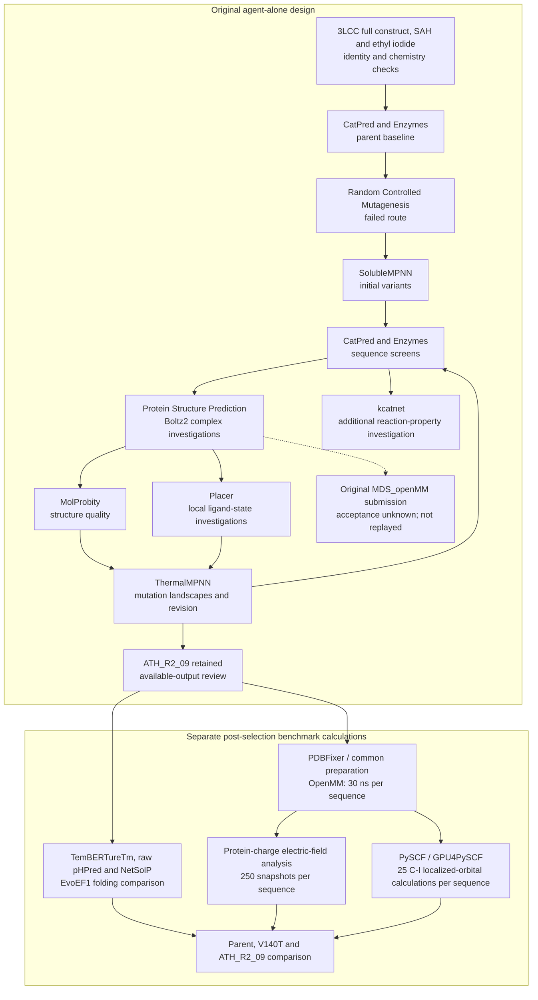

# AtHOL1 substrate expansion — executed tools and workflow

The agent used the full 235-residue 3LCC construct with SAH and ethyl iodide, generated and revised variants, and retained ATH_R2_09 for descriptive comparison. The original design run and the later matched reaction-site assessment are separate records.

## How to read this workflow

This is the recorded **agent-alone** workflow. Arrows show how outputs feed later steps; the revision loop reuses the screening and assessment tools. Failed attempts and incomplete assessments are labeled. Later reference calculations are shown separately because they did not guide the original candidate selection. No MLDE or specialist calls are part of these agent-alone runs.

## Whole workflow

## Steps and tools

| Step | Tools actually used | What happened and what was retained | Evidence |
|---|---|---|---|
| 1. Freeze the parent and reaction inputs | Public 3LCC construct; local sequence/chemistry checks | Retained native 227 residues plus LEHHHHHH, with SAH and ethyl iodide as the requested reaction inputs. | [Parent](steps/01_parent_preparation/README.md) |
| 2. Generate variants | Random Controlled Mutagenesis → SolubleMPNN | The first route failed. The first 12 SolubleMPNN records produced one unique V140A variant; the next eight produced A144S. | [Generation](steps/02_variant_generation/README.md), [sequence history](sequences/candidate_history.csv) |
| 3. Screen reaction and general properties | CatPred (`Cat_Pred`); Enzymes; kcatnet as an additional investigation | CatPred supplied the primary sequence/reaction predictions; Enzymes supplied general property screens. kcatnet provided an additional reaction-prediction route. Their returned quantities and method definitions remain separate. | [Screen outputs](steps/03_property_screening/outputs.csv), [attempt index](steps/00_execution_index/jobs.json) |
| 4. Predict and assess structural/chemical states | Protein Structure Prediction; Boltz2; MolProbity; Placer | Investigated structures, complexes and local ligand states. One disconnected-reactant Boltz2 route failed; another returned separate complexes. Placer states required chemical review. | [Assessment outputs](steps/04_structure_and_chemical_assessment/outputs.csv) |
| 5. Revise and re-evaluate | ThermalMPNN; CatPred; Enzymes; Protein Structure Prediction; MolProbity | Expanded mutation searches and repeated property/structure assessments. ATH_R2_09 was retained for descriptive comparison. The original MDS_openMM submission has an unresolved acceptance outcome and was not duplicated. | [Revision record](steps/05_revision_and_re_evaluation/README.md), [attempt A025](steps/00_execution_index/jobs.json) |
| 6. Calculate later sequence/folding properties | Enzymes / TemBERTureTm and raw pHPred; NetSolP; EvoEF1 | Compared the exact retained candidate and reconstructed V140T reference with the evaluated parent using common methods. | [Property comparison](reference_comparison/README.md), [metric table](reference_comparison/open_source_metrics.csv) |
| 7. Run a separate matched reaction-site assessment | PDBFixer; OpenMM; protein-charge Coulomb-field analysis; PySCF with GPU4PySCF acceleration and Pipek–Mezey orbital localization | Completed one 30 ns trajectory per parent, V140T and ATH_R2_09. After discarding the first 5 ns, analyzed 250 field snapshots and 25 explicit C–I localized-orbital calculations per sequence. This later assessment is not the unresolved original MDS_openMM submission. | [Protocol, identities and numerical export](steps/10_reaction_electrostatics/README.md) |

## Outcome

The original design arm closed with limitations. The separate 30 ns field/LMO assessment completed; it did not resolve an interaction improvement for the retained candidate. Neither a predicted field nor an LMO coupling is an experimental activity measurement. [Benchmark tables and figures](../../../benchmark/task_004_athol1_substrate/comparisions/benchmark_report.md).

## Records

- [Exact parent and candidate sequences](sequences/identities.json)
- [Recorded outcome](OUTCOME.json)
- [Model usage and time](USAGE_AND_TIME.md)
- [Published-reference and candidate property calculations](reference_comparison/README.md)
