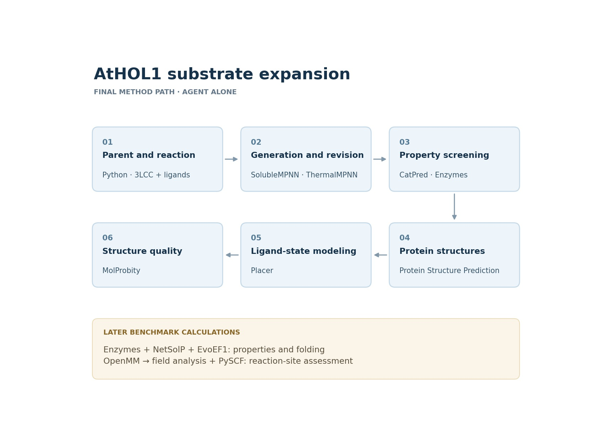

# AtHOL1 substrate expansion — workflow

The diagram shows the final method path, with later benchmark calculations in a separate panel. Relevant screens and assessments were repeated after sequence revisions.

| Stage | Tools | Work performed | Results |
|---|---|---|---|
| Parent and reaction | Python | Freeze the full 235-residue 3LCC construct with SAH and ethyl iodide. | [Records](steps/01_parent_preparation/README.md) |
| Generation and revision | SolubleMPNN; ThermalMPNN | Generate variants and use mutation landscapes for later revisions. | [Records](sequences/sha256-6c838a21eb5901a7a1420334f1803febfa06dc61cbaa23b78cfac43900577f8b-22c94851_unreported_unreported_0bd28c_unreported_unreported.csv) |
| Property screening | CatPred; Enzymes | Compare sequence/reaction predictions and general property screens. | [Records](steps/03_property_screening/sha256-54d20abb7a125cd38c8bbdf4ff2ccf1e02e8d090262bcaa9d6aea28dac20c51a-7c944909_unreported_unreported_0bd28c_unreported_unreported.csv) |
| Structure and ligand modeling | Protein Structure Prediction; Boltz2; Placer | Investigate protein structures, complex models and ligand states. | [Records](steps/04_structure_and_chemical_assessment/sha256-3068b27cf0b2a8b40ccf2243d9e12009fb24ec3358b505bbb163ba079b1bc041-7c0b819f_unreported_unreported_0bd28c_unreported_unreported.csv) |
| Quality assessment | MolProbity | Inspect the structure and chemical-state evidence for retained models. | [Records](steps/04_structure_and_chemical_assessment/README.md) |

## Benchmark calculations

Later benchmark calculations used Enzymes, NetSolP and EvoEF1. A separate matched assessment used OpenMM (30 ns per sequence), protein-field analysis and PySCF/GPU4PySCF for C–I localized-orbital calculations on the parent, V140T and ATH_R2_09.

[Property comparison](reference_comparison/README.md) · [Reaction-site assessment](steps/10_reaction_electrostatics/README.md)

[Results and outcome](README.md) · [Sequences](sequences/identities.json) · [Usage and time](README.md#usage-and-time)
