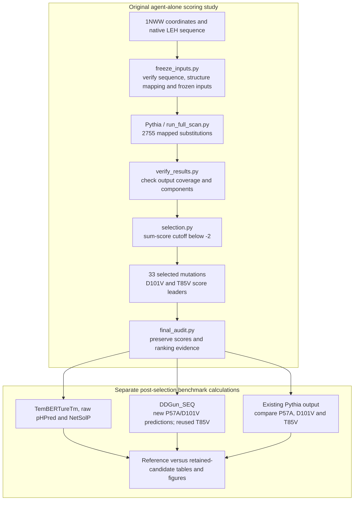

# Sun LEH / Pythia study — executed tools and workflow

This task scores substitutions on the 1NWW LEH structure. It is a structure-conditioned scoring and ranking study, rather than the longer generation/docking/chemical-validation workflow of the original LEH task.

## How to read this workflow

This is the recorded **agent-alone** workflow. Arrows show how outputs feed later steps; this scoring study has no design/revision loop. Failed attempts and incomplete assessments are labeled. Later reference calculations are shown separately because they did not guide the original candidate selection. No MLDE or specialist calls are part of these agent-alone runs.

## Whole workflow

## Steps and tools

| Step | Tools actually used | What happened and what was retained | Evidence |
|---|---|---|---|
| 1. Prepare and freeze the structure input | Local Python `freeze_inputs.py`; coordinate/sequence mapping checks | Prepared native 149-residue LEH and 1NWW coordinates for the structure-conditioned scan; froze input and model identities. | [Parent/settings record](steps/01_parent_preparation/README.md), [agent code](../../../src/task_005_sun_leh_pythia/agent-alone/) |
| 2. Score mapped substitutions | Pythia through `run_full_scan.py` | Executed the full scan of 2,755 coordinate-mapped nonidentity substitutions. Retained C/P component scores, sums and mean-score sensitivity separately. | [All scores](steps/02_pythia_scoring/all_scores.csv) |
| 3. Verify, rank and select | Local Python `verify_results.py`, `selection.py`, `final_audit.py` | Checked scan coverage and ranked by the declared sum-score convention. A cutoff below −2 selected 33 mutations. D101V and T85V were retained as score leaders; D101V changes catalytic Asp101, so ranking alone does not establish function. | [Ranked scores](steps/02_pythia_scoring/all_scores_ranked.csv), [selected mutations](steps/03_ranking/selected_sum_lt_minus2.csv) |
| 4. Calculate later property and reference comparisons | Enzymes / TemBERTureTm and raw pHPred; NetSolP; DDGun_SEQ; existing Pythia scan | Calculated common property endpoints for retained/reference sequences. New DDGun predictions covered P57A and D101V; exact T85V results and the original Pythia scan were reused, without repeating the scan. | [Property comparison](reference_comparison/README.md), [matched metric records](reference_comparison/open_source_metrics.csv) |

## Outcome

Computational scoring and ranking completed. Exact paper reproduction retains provenance/input questions; these predictions do not establish experimental enzyme improvement. [Benchmark tables and figures](../../../benchmark/task_005_sun_leh_pythia/comparisions/benchmark_report.md).

## Records

- [Exact parent and candidate sequences](sequences/identities.json)
- [Recorded outcome](OUTCOME.json)
- [Model usage and time](USAGE_AND_TIME.md)
- [Published-reference and candidate property calculations](reference_comparison/README.md)
