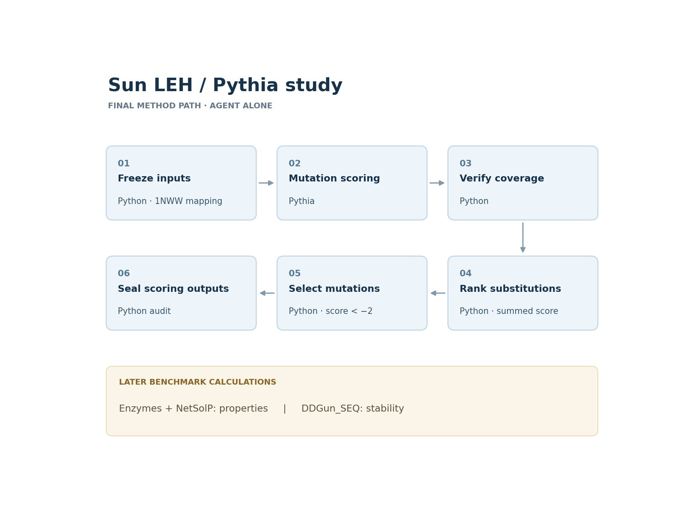

# Sun LEH / Pythia study — workflow

The diagram shows the final method path, with later benchmark calculations in a separate panel. Relevant screens and assessments were repeated after sequence revisions.

| Stage | Tools | Work performed | Results |
|---|---|---|---|
| Prepare inputs | Python freeze_inputs.py | Map the native LEH sequence to 1NWW and freeze inputs. | [Records](steps/01_parent_preparation/README.md) |
| Score mutations | Pythia / run_full_scan.py | Score all 2,755 mapped nonidentity substitutions. | [Records](steps/02_pythia_scoring/all_scores.csv) |
| Verify and rank | Python verify_results.py; selection.py | Check coverage and rank by the declared summed-score convention. | [Records](steps/02_pythia_scoring/all_scores_ranked.csv) |
| Select and seal | Python selection.py; final_audit.py | Apply score < −2, retaining 33 mutations and the scoring evidence. | [Records](steps/03_ranking/selected_sum_lt_minus2.csv) |

## Benchmark calculations

Later comparisons reused the Pythia scan and used Enzymes, NetSolP and DDGun_SEQ for common properties. D101V and T85V are score leaders; P57A is a reference comparison. These are prediction rankings.

[Property comparison](reference_comparison/README.md)

[Outcome and qualification](OUTCOME.json) · [Sequences](sequences/identities.json) · [Usage and time](USAGE_AND_TIME.md)
