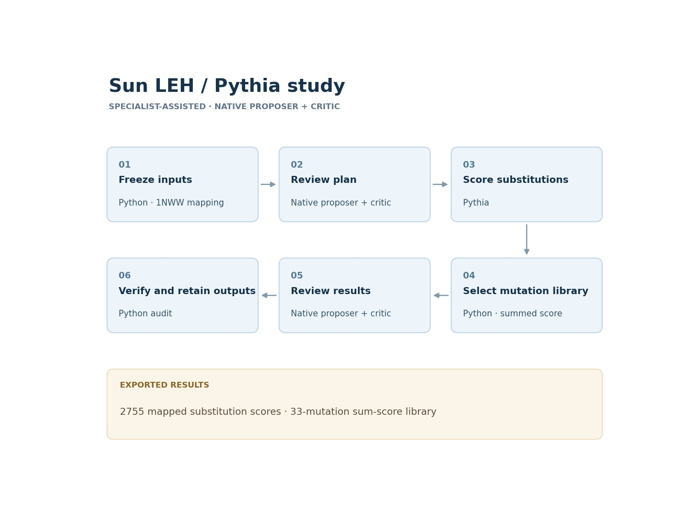

# Sun LEH / Pythia — specialist-assisted workflow

The native proposer and critic reviewed planning and result batches. The main agent executed scientific tools and retained the outputs.

| Stage | Tools | Work performed |
|---|---|---|
| Freeze inputs | Python; native proposer/critic | Verify the 1NWW mapping and declared scan inputs. |
| Score substitutions | Pythia | Execute the complete 2,755-substitution scan using two checkpoints. |
| Rank and select | Python | Retain the sum-score library and separate mean-score sensitivity. |
| Review outputs | Native proposer/critic; Python audit | Review the completed scan and preserve the original score conventions. |

[Results and outcome](README.md) · [Sequences](sequences/) · [Step outputs](steps/)
