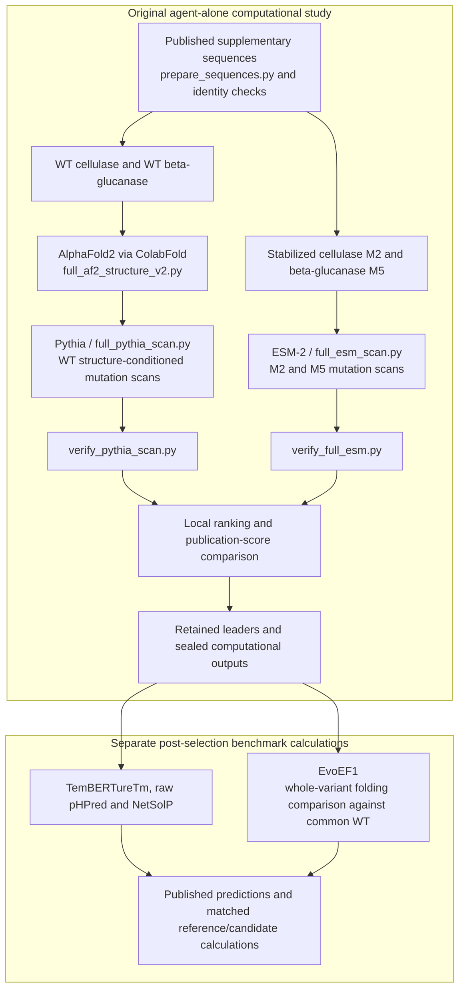

# Zhang cellulase and β-glucanase study — executed tools and workflow

The study keeps two scoring backgrounds separate: wild-type structures for Pythia, and stabilized cellulase M2 / β-glucanase M5 sequences for ESM-2. These branches feed a descriptive ranking and paper-score comparison; predicted variants were not experimentally tested here.

## How to read this workflow

This is the recorded **agent-alone** workflow. Arrows show how outputs feed later steps; the two scoring branches use different declared sequence backgrounds. Failed attempts and incomplete assessments are labeled. Later reference calculations are shown separately because they did not guide the original candidate selection. No MLDE or specialist calls are part of these agent-alone runs.

## Whole workflow

## Steps and tools

| Step | Tools actually used | What happened and what was retained | Evidence |
|---|---|---|---|
| 1. Prepare exact sequence backgrounds | Local Python `prepare_sequences.py` and identity checks | Froze the supplementary wild-type sequences and stabilized M2/M5 backgrounds separately; kept their parent/candidate mappings distinct. | [Parent/settings record](steps/01_parent_preparation/README.md), [sequence identities](sequences/identities.json) |
| 2. Predict WT structures | AlphaFold2 monomer through ColabFold, invoked by `full_af2_structure_v2.py` | Executed the full five-model prediction procedure for the declared constructs and prepared structure inputs for WT Pythia scoring. This is the structure-prediction branch, not the ESM sequence-scoring branch. | [Retained agent code](../../../src/task_006_zhang_hydrolases/agent-alone/src/full_af2_structure_v2.py) |
| 3. Score WT substitutions | Pythia through `full_pythia_scan.py`; local `verify_pythia_scan.py` | Scanned cellulase WT and β-glucanase WT, retaining C/P components and summed scores. Verified output coverage and mapping. | [Pythia step](steps/02_pythia_scoring/README.md) |
| 4. Score stabilized-background substitutions | ESM-2 through `full_esm_scan.py`; local `verify_full_esm.py` | Scanned cellulase M2 and β-glucanase M5, retaining their declared negative-log-likelihood-ratio score convention. These scores are not WT Pythia scores. | [ESM-2 step](steps/03_esm_scoring/README.md) |
| 5. Rank and compare the recorded scores | Local Python ranking and table-comparison code | Retained primary-convention leaders T131D, M2+T257K, M30P and M5+P10D. E158C/G74P remain opposite-sign diagnostic records. Same-variant published comparisons preserve the original scoring backgrounds. | [Ranking](steps/04_ranking/README.md), [published-score comparison](../../../benchmark/task_006_zhang_hydrolases/comparisions/published_prediction_only.csv) |
| 6. Calculate later physical-property and combined-variant comparisons | Enzymes / TemBERTureTm and raw pHPred; NetSolP; EvoEF1 | Recalculated common properties for retained and reconstructable reference variants. EvoEF1 scores whole combined variants against a common WT per enzyme, including published final M5/M7 variants. It does not invent missing combined Pythia/ESM paper scores. | [Property comparison](reference_comparison/README.md), [matched metric records](reference_comparison/open_source_metrics.csv) |

## Outcome

Computational structure prediction, scoring and descriptive comparisons completed. Historical settings/input eligibility retain exact-reproduction questions. [Benchmark tables and figures](../../../benchmark/task_006_zhang_hydrolases/comparisions/benchmark_report.md).

## Records

- [Exact parent and candidate sequences](sequences/identities.json)
- [Recorded outcome](OUTCOME.json)
- [Model usage and time](USAGE_AND_TIME.md)
- [Published-reference and candidate property calculations](reference_comparison/README.md)
