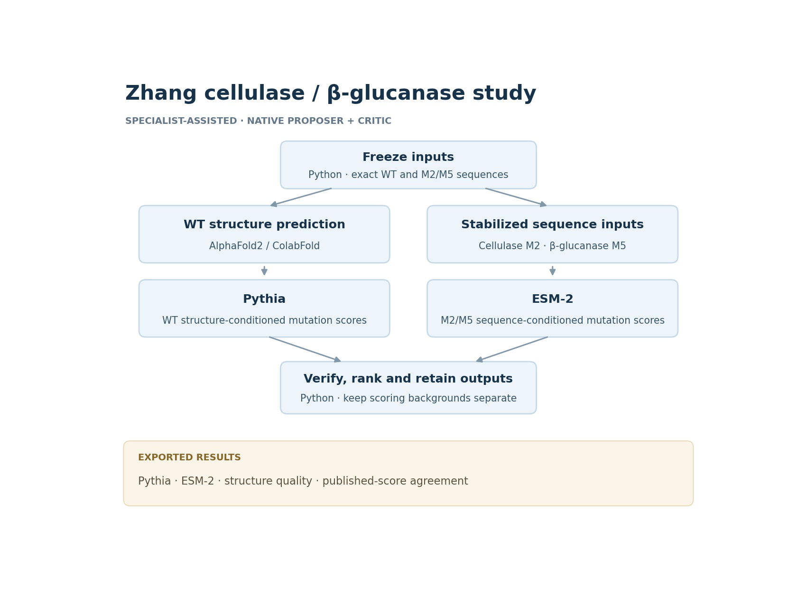

# Zhang hydrolases — specialist-assisted workflow

The native proposer and critic reviewed planning and result batches. The main agent executed scientific tools and retained the outputs.

| Stage | Tools | Work performed |
|---|---|---|
| Plan and freeze inputs | Python; native proposer/critic | Keep WT and stabilized M2/M5 sequences distinct. |
| Predict WT structures | AlphaFold2 / ColabFold | Execute all ten planned model predictions and inspect model quality. |
| Score WT substitutions | Pythia | Run structure-conditioned mutation scans for both WT enzymes. |
| Score stabilized backgrounds | ESM-2 | Run the separate sequence-based scans for cellulase M2 and β-glucanase M5. |
| Verify, rank and review | Python; native proposer/critic | Preserve score signs, declared backgrounds and paper-score comparisons. |

No additional agent-alone EvoEF or shared property predictions are copied into this assisted execution.

[Results and outcome](README.md) · [Sequences](sequences) · [Step outputs](steps)
