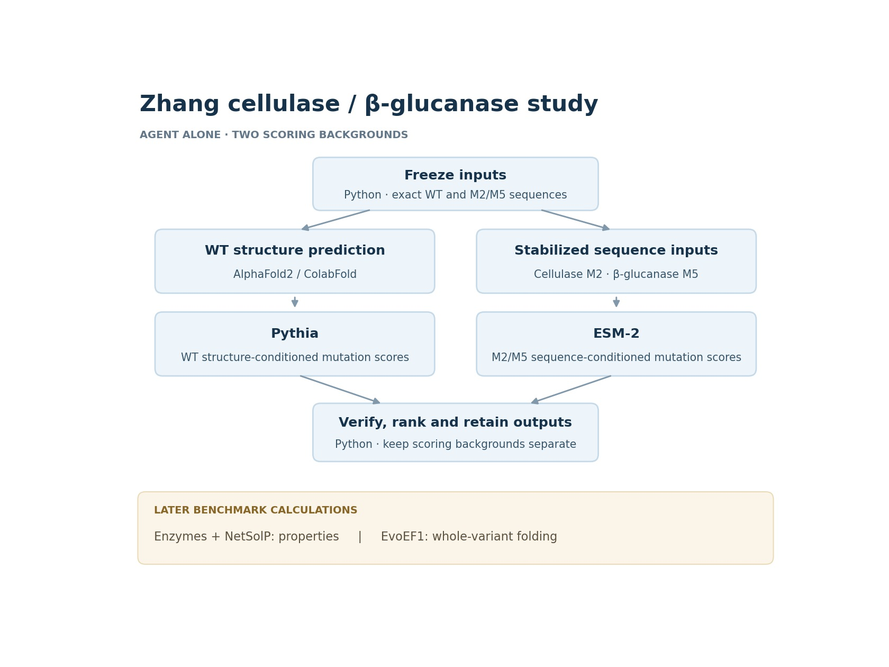

# Zhang cellulase / β-glucanase study — workflow

The WT branch uses AlphaFold2/ColabFold structures with Pythia. The separate M2/M5 branch uses sequence-based ESM-2 scoring. Python verifies and ranks the outputs while keeping these backgrounds separate; later benchmark calculations appear below.

| Stage | Tools | Work performed | Results |
|---|---|---|---|
| Prepare inputs | Python prepare_sequences.py | Freeze WT cellulase/β-glucanase and stabilized M2/M5 backgrounds separately. | [Records](steps/01_parent_preparation/README.md) |
| WT structures | AlphaFold2 monomer / ColabFold | Prepare structure inputs for WT Pythia scoring. | [Records](../../../src/task_006_zhang_hydrolases/agent-alone/src/full_af2_structure_v2.py) |
| WT mutation scoring | Pythia | Scan substitutions on WT structures and retain C/P components and summed scores. | [Records](steps/02_pythia_scoring/README.md) |
| Stabilized-background scoring | ESM-2 | Score substitutions on cellulase M2 and β-glucanase M5; this is a separate branch from WT Pythia. | [Records](steps/03_esm_scoring/README.md) |
| Verify, rank and compare | Python verification/ranking scripts | Preserve the declared scoring backgrounds and same-variant publication comparisons. | [Records](steps/04_ranking/README.md) |

## Benchmark calculations

Later benchmark calculations used Enzymes and NetSolP for properties and EvoEF1 for whole-variant folding comparisons. Published final variants and retained candidates were evaluated against their declared parents.

[Property comparison](reference_comparison/README.md)

[Results and outcome](README.md) · [Sequences](sequences/identities.json) · [Usage and time](README.md#usage-and-time)
